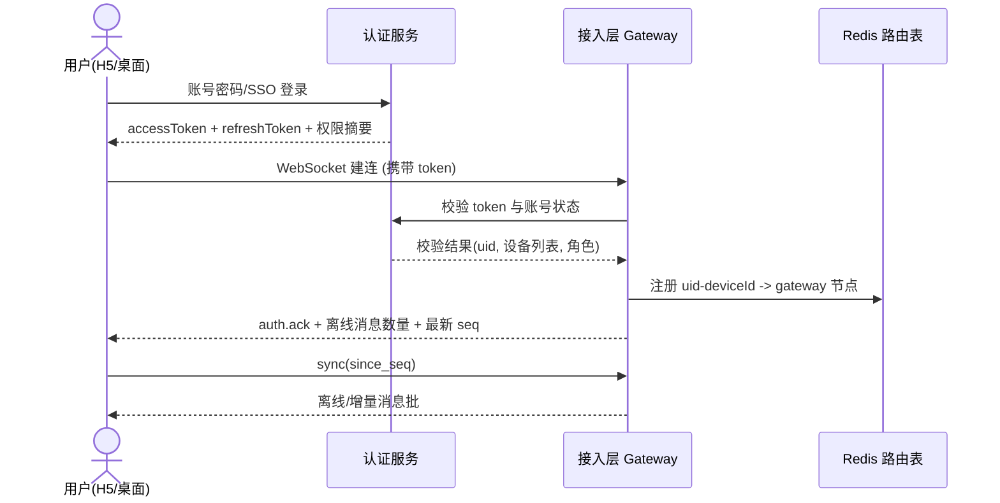
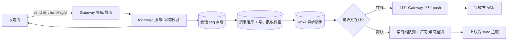
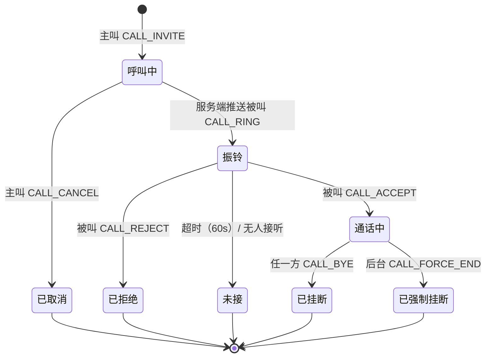

# 即时通讯（IM）应用 · 业务需求文档（BRD）

| 项目 | 内容 |
| --- | --- |
| 文档名称 | 即时通讯（IM）应用业务需求文档 |
| 版本 | v1.9 |
| 状态 | 已评审（通过） |
| 编写日期 | 2026-11-15 |
| 评审日期 | 2026-11-17 |
| 适用对象 | 产品、研发、测试、运维、安全评审 |
| 关联文档 | `docs/02-技术架构文档.md`（v1.11）、`prototype/index.html`（v1.9） |
| 原型 | `prototype/index.html`（交互原型 v1.9，含 H5 / Android 原生 / iOS 原生 / 桌面客户端 / Vue 管理后台五视图） |

### 修订记录

| 版本 | 日期 | 变更内容 | 评审意见与处理 |
| --- | --- | --- | --- |
| v1.0 | 2026-11-15 | 初稿 | — |
| v1.1 | 2026-11-15 | ① 第 4 章补充需求规模统计；② 修正第 11 章追溯矩阵中架构章节引用；③ 统一仪表盘指标口径 | 意见 1：需求编号与架构章节交叉引用有误，追溯矩阵不可靠 → 已按架构文档 v1.1 章节逐条核对修正；意见 2：优先级分布未量化，不便于排期 → 已补充统计表（P0 62 / P1 30 / P2 5 / P3 1）；意见 3：仪表盘指标与 FR-ADMIN-01 口径不一致 → 原型已补齐活跃用户、活跃群组、端分布三项指标 |
| v1.2 | 2026-11-15 | 新增音视频通话能力：4.12 章 18 条 RTC 需求、4 条 RTC 非功能指标、通话指标与验收标准、原型三端通话页面 | 音视频由 V2.0 提前至 V1.1/V1.2 分期交付；需求与架构（SFU/信令/录制/质量监控）、原型（H5 通话页、桌面通话窗口、后台通话管理）保持同版本对齐 |
| v1.3 | 2026-11-15 | 完善：新增文档导航、消息状态机与通话状态机图；补充全局搜索、消息操作、@提及与群已读、权限预览、登录日志、深色主题等交互与原型页 | 评审意见：文档篇幅大缺导航、状态流转无图、部分后台页缺失原型、无主题切换 → 全部补齐并同步升版 |
| v1.4 | 2026-11-15 | 功能细化：新增 6 条需求（FR-MSG-24~27 会话管理操作 / 一键已读 / 提醒聚合 / 转发、FR-CONTACT-07 好友申请管理、FR-ADMIN-13 公告管理）并同步原型交互 | 评审意见：会话级操作、转发、好友申请、公告均只有粗粒度描述且原型为占位 → 细化为可验收条目并真实实现交互 |
| v1.5 | 2026-11-15 | 补齐端到端主链路：新增 9 条需求（FR-AUTH-08~10 注册 / 验证码 / 登录页，FR-CONTACT-08 搜索加好友，FR-GROUP-09 发起群聊，FR-MSG-28~31 图片 / 视频 / 文档 / 多端同步可视化） | 评审意见：缺少从注册登录到加好友、建群、富媒体交流的完整闭环，多端同步仅有文字描述 → 已补齐需求与原型全流程，并新增架构接口与验证码表 |
| v1.6 | 2026-11-17 | 评审修订：① 修正文档导航需求计数（116 → 130）；② 合并重复需求 FR-ADMIN-11 / FR-ADMIN-13 为一条公告管理需求；③ 消除 FR-MSG-09 与 FR-MSG-27、FR-MSG-16 与 FR-MSG-26 的职责重叠；④ 修正产品矩阵 H5 音视频范围、FR-FILE-01 文件上限、版本规划 V1.0 范围表述、约束风险表格式、验收口径与追溯矩阵架构版本引用；⑤ 原型功能优化与死链修补（会话设置菜单、转发附留言与类型保留、提醒/公告入口、通话页回跳、注册校验、新增设置 / 组织架构 / 群聊列表 / 文件助手 / 收藏 5 个页面、表情面板、扫一扫、人员卡片、设备管理远程下线、桌面导航四视图与全局搜索、邀请成员、后台告警面板 / 表格检索 / 公告编辑 / 群详情 / 新增部门、两端会话搜索过滤、SSO 与验证码登录流程） | 评审意见：需求计数与正文不符、多条需求职责重叠、范围与验收口径存在矛盾、原型存在死链与占位交互 → 全部修正并同步原型与架构文档 v1.6 |
| v1.7 | 2026-11-17 | 新增移动端专项 4.13 节 8 条需求（FR-APP-01~08）：双平台原生客户端、系统级推送、角标与锁屏通知、权限降级、后台保活、应用内更新、锁屏来电与画中画、移动端特色交互；产品矩阵 / 技术栈 / 页面清单补充安卓、苹果原生客户端；原型新增「安卓原生 / 苹果原生」双视图（Material 与 iOS 设计语言、FAB、大标题、原生能力演示） | 评审意见：产品矩阵与原型仅覆盖 H5 / 桌面 / 后台，缺少移动端原生客户端 → 已补齐需求、页面与原型双平台视图 |
| v1.8 | 2026-11-17 | 评审修订：① 修正第 5 章“三个视图”为五视图（H5 / 安卓 / 苹果 / 桌面 / 后台）及“三端”遗留表述；② 新增 NFR-COMP-03 移动端系统兼容（Android 8.0+ / iOS 14+），非功能需求 23 → 24 条；③ 验收标准与交付物覆盖移动端（锁屏来电真机测试、五端一致性）；④ 原型补齐 FR-APP-08 手势交互（会话左滑置顶 / 免打扰 / 删除、下拉刷新）与 FR-APP-07 锁屏来电演示（CallKit / 系统来电），并完成双平台深色模式与 iOS 刘海细节 | 评审意见：v1.7 后视图数与部分“三端”表述未同步、移动端兼容性无 NFR 条目、FR-APP-07/08 在原型中仅有说明无交互 → 全部修正 |
| v1.9 | 2026-11-17 | 评审修订：① 修正 FR-APP-08 验收口径“与桌面右键菜单等价”为“互补”（左滑覆盖置顶 / 免打扰 / 删除，右键菜单含标记已读 / 清空记录）；② 追溯矩阵 FR-APP 行细化架构章节为 6.2 / 7.2 / 8.3；③ 原型补齐平板横屏双列布局演示（NFR-COMP-03）并清理全部“3 端在线”等遗留文案 | 评审意见：左滑操作与右键菜单功能集不同不可称等价、追溯矩阵章节粒度不足、原型同步状态仍显示 3 端 → 全部修正 |

---

## 文档导航

> 全文共 138 条功能需求、24 条非功能需求，按以下结构组织，可配合 `Ctrl+F` 定位。

1. **项目概述**：背景、目标、产品矩阵（1.3）、术语（1.4）
2. **用户与角色**：终端用户、后台 RBAC 内置角色、权限矩阵
3. **核心业务流程**：登录建连、消息投递、授权、消息/通话状态机
4. **功能需求**：4.1~4.13 共 13 个模块（账号、通讯录、消息、群组、文件、状态、H5、桌面、后台、RBAC、审计、音视频、移动端）
5. **页面与原型清单**：全端（H5 / 安卓 / 苹果 / 桌面 / 后台）页面与交互映射
6. **非功能需求**：性能/可用性/安全/兼容/音视频指标
7. **数据指标与报表**、8. **验收标准**、9. **版本规划**、10. **约束与风险**、11. **需求追溯矩阵**

---

## 0. 文档约定

- 需求编号规则：`FR-<模块>-<序号>`（功能需求）、`NFR-<类别>-<序号>`（非功能需求）。
- 优先级采用 MoSCoW：**P0** 必须（MVP 上线条件）、**P1** 应该（首个正式版本）、**P2** 可以（后续迭代）、**P3** 暂缓。
- 「用户」指 IM 终端使用者；「管理员」指后台管理系统的使用者；「系统」指服务端自动行为。
- 验收方式：**功能测试 / 自动化用例 / 压测报告 / 安全测评 / 人工走查**。

---

## 1. 项目概述

### 1.1 背景

企业需要一套自主可控的即时通讯平台，用于内部协作与外部客户服务沟通。现有方案依赖第三方公有云 IM，存在数据无法本地留存、权限体系无法与企业组织架构对齐、缺少统一审计与内容管控、多端体验不一致等问题。

### 1.2 产品目标

| 编号 | 目标 | 衡量指标 |
| --- | --- | --- |
| G-01 | 建立统一、可靠、低延迟的消息通道 | 单聊端到端 P99 ≤ 200ms，消息到达率 ≥ 99.99% |
| G-02 | 覆盖全终端办公场景 | H5 + Windows / Linux / macOS 桌面端 + Vue 管理后台同时交付 |
| G-03 | 权限与组织体系对齐企业治理 | 基于 RBAC 的菜单 / 接口 / 按钮 / 数据四维授权，全部操作可审计 |
| G-04 | 满足合规与内容安全要求 | 消息留痕、敏感词、审计检索、封禁与撤回能力齐备 |
| G-05 | 支持私有化与水平扩展 | 支持单机 / 容器化 / K8s 部署，接入层可水平扩容 |

### 1.3 产品矩阵与范围

| 端 | 形态 | 目标用户 | 本期范围 | 不在本期范围 |
| --- | --- | --- | --- | --- |
| Go 服务端 | 微服务 + 长连接接入层 | 全端 | 认证、消息、关系、群组、文件、推送、管理 API、审计 | 第三方 IM 互通、开放平台 SDK |
| H5 端 | 移动浏览器 / PWA / 企业微信内嵌 | 移动办公用户 | 会话、聊天、通讯录、个人设置、1v1 与群组音视频通话 | 小程序端、屏幕共享（H5 仅观看） |
| 安卓原生客户端 | Android 8.0+（手机 / 平板） | 移动办公用户 | 消息、通讯录、音视频通话、系统级推送、锁屏接听、角标、应用内更新 | 小程序端、屏幕共享（观看） |
| 苹果原生客户端 | iOS 14+（iPhone / iPad） | 移动办公用户 | 消息、通讯录、音视频通话、APNs 推送、锁屏接听、角标、画中画 | 小程序端、屏幕共享（观看） |
| 桌面客户端 | Windows / Linux / macOS 跨端应用 | 日常办公主力用户 | 三栏 IM 界面、系统通知、托盘、文件拖拽、快捷键、多端同步 | 屏幕共享、远程协助 |
| 管理后台 | Vue 3 单页应用 | 运营 / 管理员 / 审计员 | 仪表盘、用户、组织、RBAC、群组、消息审计、配置 | 自定义报表设计器 |
| 音视频 | 独立通话窗口 + SFU 媒体服务 | 全端用户 | 1v1 语音 / 视频、群组通话、通话记录、质量监控 | 屏幕共享（V1.2）、端到端加密通话（V2.0） |

### 1.4 术语表

| 术语 | 含义 |
| --- | --- |
| 会话（Conversation） | 单聊或群聊的消息容器，具备独立自增 `seq` |
| 消息（Message） | 会话内最小投递单元，全局唯一 `msgId`，客户端幂等键 `clientMsgId` |
| 接入层（Gateway） | 维护客户端长连接、协议编解码、路由与下行推送 |
| 写扩散 / 读扩散 | 单聊按收件箱写扩散；大群按会话写一份、成员按 `seq` 拉取 |
| 多端同步 | 同一账号在 H5 / 多个桌面端同时在线，消息与已读状态一致 |
| 已读回执 | 接收方上报最大连续已读 `seq`，发送方展示「已读 / 未读」 |
| RBAC | 基于角色的访问控制：用户 → 角色 → 权限 → 资源 |
| 资源 | 菜单、接口（URL+Method）、按钮/操作点、数据范围 |
| 数据权限 | 限定角色可见的数据集合（全部 / 本部门及下级 / 本部门 / 仅本人） |
| 审计日志 | 记录后台所有写操作与敏感读操作的不可篡改日志 |
| WebRTC | 浏览器与客户端内置的实时音视频技术栈（`getUserMedia` / `RTCPeerConnection`） |
| SFU | Selective Forwarding Unit，选择性转发单元，接收各端媒体流按需转发，不混流 |
| SDP / ICE | 会话描述协议（媒体能力协商）与交互式连接建立（候选地址探测） |
| TURN / STUN | NAT 穿透服务：STUN 发现公网映射，TURN 在中继失败时转发媒体 |
| Simulcast / SVC | 多档同时编码发送 / 可分层编码，供 SFU 按需选层应对弱网 |
| NACK / FEC / PLI | 丢包重传请求、前向纠错、关键帧请求等抗弱网机制 |
| MOS | 平均主观分（1~5），通话质量综合评价指标，≥ 4.0 为良好 |

---

## 2. 用户与角色

### 2.1 终端用户角色

| 角色 | 说明 | 典型诉求 |
| --- | --- | --- |
| 普通成员 | 组织内正式员工 | 单聊、群聊、文件、消息搜索、多端同步 |
| 群主 / 群管理员 | 群的管理者 | 成员管理、禁言、公告、入群审批、解散群 |
| 外部联系人 | 受邀的外部协作方（可选） | 限定会话范围，受更严格审计策略约束 |
| 系统账号 | 机器人 / 通知服务 | 通过服务端 API 推送系统通知 |

### 2.2 后台管理角色（RBAC 内置角色）

| 角色编码 | 角色名 | 职责 | 默认数据范围 |
| --- | --- | --- | --- |
| `SUPER_ADMIN` | 超级管理员 | 全部功能，含角色授权、系统配置 | 全部 |
| `OPS_ADMIN` | 运营管理员 | 用户、组织、群组、内容策略、公告 | 全部 |
| `AUDITOR` | 审计员 | 消息审计、登录日志、操作日志（只读 + 导出） | 全部（只读） |
| `DEPT_ADMIN` | 部门管理员 | 本部门及下级用户与群组维护 | 本部门及下级 |
| `SUPPORT` | 客服主管 | 工单关联会话查看、举报处理 | 本部门 |

> 角色由超级管理员自定义创建，内置角色仅作为初始模板，可修改但不可删除。一个用户可绑定多个角色，权限取**并集**，数据范围取**最宽集合**。

### 2.3 角色—权限矩阵（摘要）

| 功能 / 角色 | 超级管理员 | 运营管理员 | 审计员 | 部门管理员 | 客服主管 |
| --- | --- | --- | --- | --- | --- |
| 仪表盘查看 | ✓ | ✓ | ✓ | ✓ | ✓ |
| 用户启停 / 重置密码 | ✓ | ✓ | ✗ | ✓（本部门） | ✗ |
| 组织架构编辑 | ✓ | ✓ | ✗ | ✗ | ✗ |
| 角色与权限配置 | ✓ | ✗ | ✗ | ✗ | ✗ |
| 群组解散 / 成员移除 | ✓ | ✓ | ✗ | ✓（本部门） | ✗ |
| 消息审计检索 | ✓ | ✓ | ✓ | ✗ | ✓（本部门） |
| 敏感词策略 | ✓ | ✓ | ✗ | ✗ | ✗ |
| 审计日志导出 | ✓ | ✗ | ✓ | ✗ | ✗ |
| 系统参数配置 | ✓ | ✗ | ✗ | ✗ | ✗ |

---

## 3. 核心业务流程

### 3.1 用户登录与建连

### 3.2 单聊消息投递

### 3.3 后台授权流程

---

## 4. 功能需求

**需求规模统计**：共 138 条功能需求（P0 85 / P1 45 / P2 7 / P3 1）、24 条非功能需求。P0 为 MVP 与 V1.0 上线的强制范围。

| 模块 | 需求数 | P0 | P1 | P2 | P3 |
| --- | --- | --- | --- | --- | --- |
| 4.1 账号与认证 | 10 | 6 | 4 | — | — |
| 4.2 通讯录与关系 | 8 | 5 | 3 | — | — |
| 4.3 会话与消息 | 31 | 19 | 10 | 1 | 1 |
| 4.4 群组 | 9 | 7 | 2 | — | — |
| 4.5 文件与多媒体 | 6 | 3 | 2 | 1 | — |
| 4.6 在线状态与通知 | 4 | 1 | 3 | — | — |
| 4.7 H5 端专项 | 6 | 4 | 1 | 1 | — |
| 4.8 桌面客户端专项 | 9 | 4 | 4 | 1 | — |
| 4.9 管理后台专项 | 12 | 10 | 2 | — | — |
| 4.10 RBAC 权限管理 | 12 | 10 | 1 | 1 | — |
| 4.11 审计与合规 | 5 | 2 | 3 | — | — |
| 4.12 音视频通话 | 18 | 10 | 6 | 2 | — |
| 4.13 移动端专项 | 8 | 4 | 4 | — | — |
| **合计** | **138** | **85** | **45** | **7** | **1** |

### 4.1 账号与认证 `FR-AUTH`

| 编号 | 需求 | 优先级 | 验收要点 |
| --- | --- | --- | --- |
| FR-AUTH-01 | 支持账号密码登录，密码加盐哈希存储，错误次数锁定 | P0 | 连续 5 次错误锁定 10 分钟 |
| FR-AUTH-02 | 支持企业 SSO / OAuth2 / LDAP 对接（配置项开关） | P1 | 开启后可用企业账号登录 |
| FR-AUTH-03 | 双令牌机制：`accessToken` 2h、`refreshToken` 7d，支持主动失效 | P0 | 踢下线后旧 token 立即不可用 |
| FR-AUTH-04 | 多端登录策略：同类设备互踢、异类设备共存，可配置最大在线数 | P0 | H5 后登录踢掉前一个 H5；桌面端不受影响 |
| FR-AUTH-05 | 管理员登录强制二次验证（MFA / 邮箱验证码，可配置） | P1 | 超级管理员默认开启 |
| FR-AUTH-06 | 账号状态：正常 / 禁用 / 注销；禁用即断开所有长连接 | P0 | 禁用后 5s 内全端下线 |
| FR-AUTH-07 | 设备列表查看与远程下线 | P1 | 展示设备类型、IP、最后活跃时间 |
| FR-AUTH-08 | 账号注册：手机号 + 验证码 + 密码，昵称必填、头像可选；密码 8~20 位且含字母与数字；注册成功即登录并生成默认会话 | P0 | 重复手机号拦截，协议必须勾选，注册全程 ≤ 30s |
| FR-AUTH-09 | 短信/邮箱验证码：6 位数字、5 分钟有效、一次性使用；同号码 60s 一次、每日 10 次；连续错误 5 次失效 | P0 | 超频返回明确错误码，验证码不可复用 |
| FR-AUTH-10 | 登录页能力：账号密码 / 验证码 / 企业 SSO 三种方式；记住我、忘记密码、服务协议与隐私政策入口 | P1 | 首屏 1.5s 内可交互，协议可查看 |

### 4.2 通讯录与关系 `FR-CONTACT`

| 编号 | 需求 | 优先级 | 验收要点 |
| --- | --- | --- | --- |
| FR-CONTACT-01 | 组织架构树（部门 → 子部门 → 成员），支持层级展示与搜索 | P0 | 万级节点搜索响应 < 300ms |
| FR-CONTACT-02 | 人员卡片：姓名、头像、部门、职位、手机号、邮箱、在线状态 | P0 | 卡片可直接发起会话 |
| FR-CONTACT-03 | 好友申请 / 通过 / 拒绝 / 删除好友 | P1 | 申请消息走系统通知会话 |
| FR-CONTACT-04 | 黑名单：拉黑后不再接收对方消息，双方关系解除 | P1 | 拉黑对历史会话保留但禁止新消息 |
| FR-CONTACT-05 | 按姓名 / 拼音 / 手机号 / 部门模糊搜索人员 | P0 | 支持拼音首字母 |
| FR-CONTACT-06 | 组织架构由后台维护并实时同步到所有端 | P0 | 变更后 60s 内客户端刷新 |
| FR-CONTACT-07 | 好友申请管理：申请列表分「待处理 / 已处理」，展示申请留言与来源（搜索 / 群聊 / 名片）；支持通过（可选备注与分组）、拒绝；申请超时 7 天自动过期 | P1 | 双方状态一致，通过后可立即发起会话 |
| FR-CONTACT-08 | 搜索添加好友：按手机号 / 昵称 / 部门模糊搜索，结果展示用户卡片（头像、部门、职位）；可填写附言与备注后发送申请，已申请状态防重复提交 | P0 | 搜索 P95 ≤ 300ms，重复申请被拦截并提示 |

### 4.3 会话与消息 `FR-MSG`

| 编号 | 需求 | 优先级 | 验收要点 |
| --- | --- | --- | --- |
| FR-MSG-01 | 会话列表：头像、名称、最后一条消息摘要、时间、未读数、置顶、免打扰 | P0 | 按最后消息时间倒序，置顶优先 |
| FR-MSG-02 | 单聊文本消息收发，端到端 P99 ≤ 200ms | P0 | 压测报告 |
| FR-MSG-03 | 消息类型：文本、表情、图片、语音、文件、位置、富文本卡片、系统通知 | P0 | 各类型可渲染、可下载 |
| FR-MSG-04 | 群聊：最多 2000 人，支持 @成员 / @全体、群公告 | P0 | 大群 500 人压测通过 |
| FR-MSG-05 | 消息可靠性：不丢、不重、有序；客户端 `clientMsgId` 幂等去重 | P0 | 弱网重试 100 次仅一条 |
| FR-MSG-06 | 消息状态：发送中 → 已发送 → 已送达 → 已读；失败可重发 | P0 | 状态双向同步到发送者所有端 |
| FR-MSG-07 | 已读回执：单聊与群聊（群聊展示已读人数 / 未读人数） | P1 | 多端已读取最大 `seq` |
| FR-MSG-08 | 消息撤回：2 分钟内可撤回自己的消息；群主/管理员可撤回成员消息 | P0 | 各端同步替换展示 |
| FR-MSG-09 | 消息删除（仅自己可见）、合并转发、收藏（单一转发见 FR-MSG-27） | P1 | 删除不影响对方 |
| FR-MSG-10 | 离线消息：上线按 `seq` 增量拉取，支持分页与批量压缩 | P0 | 7 天内消息完整 |
| FR-MSG-11 | 多端同步：消息、已读、撤回、置顶、草稿全端一致 | P0 | 多端同时在线验证 |
| FR-MSG-12 | 历史消息漫游：云端保留 180 天（可配置），按会话分页拉取 | P0 | 换设备可查历史 |
| FR-MSG-13 | 全局消息搜索：按关键字 / 发送人 / 时间范围 / 会话 / 文件类型 | P1 | 千万级数据检索 < 1s |
| FR-MSG-14 | 输入中状态、正在输入提示 | P2 | 节流 3s，不落库 |
| FR-MSG-15 | 草稿自动保存（本地 + 云端） | P1 | 切换会话不丢失 |
| FR-MSG-16 | 消息引用回复：引用原消息展示摘要与发送者，点击可定位到原消息（提醒聚合见 FR-MSG-26） | P1 | 点击定位到原消息 |
| FR-MSG-17 | 未读计数角标：会话级 + 应用级总数，桌面端任务栏 / Dock 角标 | P0 | 与服务端未读一致 |
| FR-MSG-18 | 断线自动重连（指数退避）+ 本地队列补发 | P0 | 断网 30s 恢复后无丢失 |
| FR-MSG-19 | 本地消息缓存，弱网/离线可查看已缓存会话 | P1 | H5 IndexedDB、桌面 SQLite |
| FR-MSG-20 | 系统通知会话：好友申请、入群、账号风险、后台公告 | P1 | 不可由用户发送 |
| FR-MSG-21 | 消息发送频率限制与反骚扰（可配置阈值） | P0 | 超限返回明确错误码 |
| FR-MSG-22 | 消息内容敏感词检测：命中拦截 / 替换 / 仅告警三种策略 | P0 | 策略后台可配置 |
| FR-MSG-23 | 端到端加密消息类型预留（消息体中标记 `e2ee`） | P3 | 协议字段预留，不实现 |
| FR-MSG-24 | 会话管理操作：会话右键 / 长按菜单支持置顶与取消置顶、消息免打扰开关、标记本条已读、清空本地聊天记录（不影响对方与云端漫游） | P0 | 操作后 3s 内多端同步，云端漫游仍可拉取 |
| FR-MSG-25 | 一键已读：会话列表提供「全部已读」入口，批量清除未读并按会话上报最大已读 `seq` | P1 | 角标即时清零且与服务端一致 |
| FR-MSG-26 | 提醒聚合：@我的消息与引用我的消息聚合到「提醒我」列表（按时间倒序），点击定位到原会话与原消息 | P1 | 覆盖单聊与群聊，条目保留 30 天 |
| FR-MSG-27 | 消息转发：支持转发到多个最近会话或搜索选择目标，转发时可附留言；转发消息保留原始类型与发送者署名 | P1 | 目标会话双方可见，与原消息相互独立 |
| FR-MSG-28 | 图片消息：相册 / 拍照选择，客户端压缩后上传，气泡展示缩略图，点击查看大图并支持保存与转发 | P0 | 20MB 内图片可发，缩略图 ≤ 50KB，查看不卡顿 |
| FR-MSG-29 | 视频消息：选择视频上传，服务端转码 HLS，气泡展示封面与时长，点击播放支持倍速与全屏 | P0 | 500MB 内可发，首帧 ≤ 1s，弱网自动降码率 |
| FR-MSG-30 | 文档消息：文件选择、分片上传与秒传，气泡展示类型图标、文件名与大小，下载走预签名 URL，支持 Office / PDF 在线预览 | P0 | 100MB 内可发，下载 URL 15 分钟有效 |
| FR-MSG-31 | 多端同步可视化：客户端展示同步状态（同步中 / 已同步 / N 端在线）与各端同步游标；发送后其他端 1s 内可见，断线重连自动补齐缺口 | P0 | 多端游标一致，缺口触发 SYNC 补齐 |

### 4.4 群组 `FR-GROUP`

| 编号 | 需求 | 优先级 | 验收要点 |
| --- | --- | --- | --- |
| FR-GROUP-01 | 创建群、设置群名 / 头像 / 公告 / 简介 | P0 | 创建者自动成为群主 |
| FR-GROUP-02 | 邀请成员、扫码/链接入群、入群审批开关 | P0 | 审批消息推送给群主 |
| FR-GROUP-03 | 成员移除、主动退群、群主转让、解散群 | P0 | 解散后全员收到系统消息 |
| FR-GROUP-04 | 角色：群主 / 管理员 / 普通成员；管理员由群主任命 | P0 | 权限差异明确 |
| FR-GROUP-05 | 全员禁言 / 单人禁言（可设置时长） | P1 | 禁言期间发送被拒 |
| FR-GROUP-06 | 群成员上限 2000，默认 500（后台可配置） | P0 | 超限提示 |
| FR-GROUP-07 | 群设置：消息免打扰、置顶、保存到通讯录 | P1 | 多端同步 |
| FR-GROUP-08 | 后台可查看、冻结、解散任意群并留存记录 | P0 | 操作写入审计日志 |
| FR-GROUP-09 | 发起群聊：从通讯录多选成员（支持搜索与已选头像预览），创建时设置群名称；创建成功自动生成群会话、发送系统消息并通知成员 | P0 | 至少选择 1 人，成员 3s 内收到会话 |

### 4.5 文件与多媒体 `FR-FILE`

| 编号 | 需求 | 优先级 | 验收要点 |
| --- | --- | --- | --- |
| FR-FILE-01 | 图片 / 语音 / 文件发送，单文件默认上限 100MB（视频 500MB，见 FR-MSG-29；均后台可配置） | P0 | 超限前置拦截 |
| FR-FILE-02 | 分片上传、断点续传、秒传（哈希去重） | P1 | 中断后可继续 |
| FR-FILE-03 | 图片缩略图、语音时长、文件图标与类型识别 | P0 | 列表与气泡展示 |
| FR-FILE-04 | 下载鉴权：带签名的临时 URL，有效期可配置 | P0 | 过期 URL 返回 403 |
| FR-FILE-05 | 病毒扫描 / 文件类型黑名单（可对接企业扫描服务） | P1 | 命中拒绝并告警 |
| FR-FILE-06 | 文件过期清理策略与存储用量统计 | P2 | 后台报表可见 |

### 4.6 在线状态与通知 `FR-PRESENCE`

| 编号 | 需求 | 优先级 | 验收要点 |
| --- | --- | --- | --- |
| FR-PRES-01 | 在线 / 离线 / 忙碌 / 隐身状态，好友与会话可见 | P1 | 心跳 30s，掉线 90s 判定离线 |
| FR-PRES-02 | 多端状态聚合：任一端在线即在线，可展示「手机/桌面在线」 | P1 | 状态变更广播 |
| FR-PRES-03 | H5 页面通知 / 桌面系统通知 / 托盘闪烁，展示发送人与摘要 | P0 | 免打扰会话不弹通知 |
| FR-PRES-04 | 后台推送全员公告（按部门 / 角色 / 全量定向） | P1 | 阅读率统计 |

### 4.7 H5 端专项 `FR-H5`

| 编号 | 需求 | 优先级 | 验收要点 |
| --- | --- | --- | --- |
| FR-H5-01 | 移动端自适应（320~768px），支持 iOS Safari / Android Chrome / 微信内置浏览器 | P0 | 主流机型兼容测试 |
| FR-H5-02 | 底部 Tab：消息 / 通讯录 / 发现（可选） / 我的 | P0 | 与原型一致 |
| FR-H5-03 | PWA：可添加到桌面、离线壳、基础缓存 | P2 | Lighthouse 可安装 |
| FR-H5-04 | 弱网优化：本地队列、发送中状态、失败重发入口 | P0 | 2G/高丢包模拟 |
| FR-H5-05 | 相册/拍照上传、语音录制（浏览器能力降级处理） | P1 | 不支持时给出替代方案 |
| FR-H5-06 | 后台切前台自动重连与增量同步 | P0 | 页面 visibilitychange 触发 |

### 4.8 桌面客户端专项 `FR-PC`

| 编号 | 需求 | 优先级 | 验收要点 |
| --- | --- | --- | --- |
| FR-PC-01 | Windows 10+ / macOS 11+ / Ubuntu 20.04+ 三平台安装包，界面与交互一致 | P0 | 三平台冒烟测试 |
| FR-PC-02 | 三栏布局：导航 / 会话列表 / 聊天区（可展开群成员面板） | P0 | 与原型一致 |
| FR-PC-03 | 系统托盘：最小化到托盘、未读角标、右键菜单、开机自启 | P0 | 三平台可用（Linux 按桌面环境适配） |
| FR-PC-04 | 全局快捷键：呼出主窗口、快速搜索、截图、发送消息 | P1 | 可自定义、冲突检测 |
| FR-PC-05 | 文件拖拽发送、粘贴图片、截图粘贴发送 | P0 | 常见格式验证 |
| FR-PC-06 | 本地 SQLite 加密缓存消息，提升冷启动速度 | P1 | 缓存加密，登出可清除 |
| FR-PC-07 | 自动更新（差分增量包）、签名校验、回滚 | P1 | 升级不丢本地数据 |
| FR-PC-08 | 多窗口：独立聊天窗口、会话置顶窗口 | P2 | 窗口状态同步 |
| FR-PC-09 | 崩溃日志上报（脱敏） | P1 | 后台可查 |

### 4.9 管理后台专项 `FR-ADMIN`

| 编号 | 需求 | 优先级 | 验收要点 |
| --- | --- | --- | --- |
| FR-ADMIN-01 | 仪表盘：在线人数、今日消息量、活跃用户、群数、消息趋势图、登录分布、系统健康度 | P0 | 近 7 / 30 天切换 |
| FR-ADMIN-02 | 用户管理：列表 / 搜索 / 新增 / 编辑 / 禁用 / 重置密码 / 导出 / 查看详情与设备 | P0 | 按数据范围过滤 |
| FR-ADMIN-03 | 组织架构：部门树增删改、拖动调整层级、成员归属调整 | P0 | 变更同步到客户端 |
| FR-ADMIN-04 | 群组管理：群列表、成员查看、冻结 / 解散、群消息量统计 | P0 | 操作二次确认 |
| FR-ADMIN-05 | 角色权限：角色 CRUD、权限树勾选、角色成员分配、权限预览 | P0 | 详见 4.10 |
| FR-ADMIN-06 | 消息审计：按用户 / 会话 / 时间 / 关键字检索消息，支持导出（受权限与脱敏策略控制） | P0 | 审计操作本身留痕 |
| FR-ADMIN-07 | 内容安全：敏感词库（导入 / 导出 / 分类）、命中策略、命中记录、举报处理 | P0 | 策略变更 1 分钟内生效 |
| FR-ADMIN-08 | 操作日志：谁、何时、从哪个 IP、对什么对象、做了什么、结果，支持检索与导出 | P0 | 日志不可从界面删除 |
| FR-ADMIN-09 | 登录日志与异常登录告警（异地 / 高频失败） | P1 | 可配置告警阈值 |
| FR-ADMIN-10 | 系统设置：消息保留天数、文件大小、群上限、登录策略、通知开关、存储配置 | P0 | 配置热生效或提示重启 |
| FR-ADMIN-11 | 公告管理：创建 / 编辑 / 下线公告，支持定时发布、定向范围（全员 / 部门 / 角色）、富文本与附件、置顶与有效期；到达客户端系统通知会话并提供已读率统计 | P1 | 定向范围内全员可达，已读率实时更新 |
| FR-ADMIN-12 | 个人中心：修改密码、绑定 MFA、查看自己权限 | P0 | 所有角色可见 |

### 4.10 RBAC 权限管理 `FR-RBAC`（核心）

| 编号 | 需求 | 优先级 | 验收要点 |
| --- | --- | --- | --- |
| FR-RBAC-01 | 模型：`用户 — 用户角色关联 — 角色 — 角色权限关联 — 权限(资源)` | P0 | 五张核心表，见架构文档 |
| FR-RBAC-02 | 资源类型：① 目录/菜单 ② 接口（URL + HTTP Method） ③ 按钮/操作点 ④ 数据范围 | P0 | 权限树按此四类分组 |
| FR-RBAC-03 | 权限树支持父子联动勾选、半选状态、搜索过滤、全选/清空 | P0 | 保存后即时生效 |
| FR-RBAC-04 | 支持多角色、角色继承（父角色权限自动下传）、角色优先级 | P1 | 循环继承校验拦截 |
| FR-RBAC-05 | 数据范围：全部 / 本部门及下级 / 本部门 / 仅本人 / 自定义部门集合 | P0 | 列表查询自动注入范围条件 |
| FR-RBAC-06 | 前端动态路由：按权限码过滤路由表，未授权路由跳转 403 | P0 | 手动输入 URL 也不可访问 |
| FR-RBAC-07 | 按钮级权限：`v-permission="'user:disable'"` 指令控制显隐 | P0 | 无权限按钮不渲染 |
| FR-RBAC-08 | 服务端强制校验：网关中间件校验接口权限，禁止仅依赖前端控制 | P0 | 直接调用 API 返回 403 |
| FR-RBAC-09 | 权限缓存与失效：Redis 缓存用户权限摘要，角色变更主动失效 | P0 | 变更 5s 内全端生效 |
| FR-RBAC-10 | 内置超级管理员绕过权限校验但所有操作仍记录审计 | P0 | 审计日志完整 |
| FR-RBAC-11 | 角色变更、授权变更、管理员登录均写入审计日志 | P0 | 含变更前后的值 |
| FR-RBAC-12 | 权限预览：选择用户查看其最终权限来源与冲突说明 | P2 | 便于排障 |

### 4.11 审计与合规 `FR-SEC`

| 编号 | 需求 | 优先级 | 验收要点 |
| --- | --- | --- | --- |
| FR-SEC-01 | 后台所有写操作记录审计日志，保留 ≥ 180 天 | P0 | 日志追加写、禁止修改 |
| FR-SEC-02 | 消息留存按系统设置执行，到期归档后删除 | P0 | 归档可恢复 |
| FR-SEC-03 | 敏感操作（导出消息、重置密码、解散群）二次确认 + MFA | P1 | 流程可配置 |
| FR-SEC-04 | 日志与导出文件脱敏（手机号、邮箱按角色掩码显示） | P1 | 审计员可见完整值需单独授权 |
| FR-SEC-05 | 举报入口：客户端举报消息/用户，后台工单化处理 | P1 | 状态流转可追踪 |

### 4.12 音视频通话 `FR-RTC`

**通话状态机**（对应 FR-RTC-01，信令命令字见架构 6.6）：

| 编号 | 需求 | 优先级 | 验收要点 |
| --- | --- | --- | --- |
| FR-RTC-01 | 1v1 语音通话：呼叫、振铃、接听、拒绝、挂断、取消，全程状态机明确 | P0 | 各状态转换与提示正确，取消后对方无残留界面 |
| FR-RTC-02 | 1v1 视频通话：本地 / 远端画面、切换前后摄像头、H5 美颜开关、画面自适应（缩放/填充） | P0 | 三平台一致，横竖屏自适应 |
| FR-RTC-03 | 群组音视频通话：最多 9 路视频 / 32 人语音，SFU 转发、成员进出、全员静音、举手、成员管理 | P1 | 9 路视频同时渲染不降级异常 |
| FR-RTC-04 | 通话与消息融合：呼叫以通话卡片进入会话，展示未接 / 已接 / 时长，可一键回拨 | P0 | 卡片在会话列表与聊天页一致展示 |
| FR-RTC-05 | 多端登录来电策略：按设备优先级振铃（桌面端优先），可在一端接听后自动取消其他端振铃，支持通话中转移到其他端 | P1 | 多端同时在线仅一个端持续振铃 |
| FR-RTC-06 | 通话质量保障：自适应码率、NACK 重传、FEC 前向纠错、Jitter Buffer、Opus 带内 FEC、DTX 静音检测 | P0 | 满足 NFR-RTC-01/02 指标 |
| FR-RTC-07 | 弱网与网络切换：带宽不足时自动降分辨率或切语音；Wi-Fi / 4G / 5G 切换不断话；断网 3 秒内自动恢复 | P1 | 弱网模拟（丢包 10%）仍可通话 |
| FR-RTC-08 | 通话中消息：通话界面可查看会话历史、发送文字消息、发送图片 | P1 | 桌面端优先，H5 支持文字 |
| FR-RTC-09 | 通话录制：服务端 / 客户端录制，文件落对象存储，后台按权限回放与下载，保留期与消息一致 | P1 | 未授权角色无回放入口 |
| FR-RTC-10 | 通话记录：全局通话记录列表（时间、类型、成员、时长、质量、流量），支持回拨与按人检索 | P0 | 记录云端漫游 |
| FR-RTC-11 | 通话质量监控：后台可视化 MOS 分布、卡顿率、丢包率、接通率、并发数，异常自动告警 | P1 | 指标与客户端上报一致 |
| FR-RTC-12 | 屏幕共享：桌面端发起屏幕 / 窗口共享，H5 与其他端仅观看，可随时停止 | P2 | 共享时自动切换高码率档 |
| FR-RTC-13 | 通话安全：全链路 SRTP / DTLS 加密、TURN 中继鉴权、信令鉴权与防重放、房间令牌校验 | P0 | 非法令牌无法加入房间 |
| FR-RTC-14 | 权限与管控：后台可禁止指定账号 / 群发起通话、强制挂断进行中通话、限制并发数 | P0 | 管控 5 秒内生效并通知双方 |
| FR-RTC-15 | 通话中状态：头像与好友列表展示「通话中」，同步到所有端，支持自定义状态文案 | P1 | 状态广播及时 |
| FR-RTC-16 | 免打扰策略：免打扰会话 / 全局勿扰时来电不响铃，仅记录未接来电；白名单可穿透 | P1 | 策略与消息免打扰一致 |
| FR-RTC-17 | 跨平台一致性：H5 与三平台桌面端通话能力、界面布局、控制项一致，接口与协议统一 | P0 | 三平台冒烟 + 一致性走查 |
| FR-RTC-18 | 并发与容量：平台并发 500 路 1v1、单群最多 32 人通话；单 SFU 节点支撑 200 路转发 | P1 | 压测报告 |

---

### 4.13 移动端专项 `FR-APP`

> 覆盖**安卓原生客户端**（Android 8.0+，Kotlin + Jetpack Compose）与**苹果原生客户端**（iOS 14+，Swift + SwiftUI）。核心 IM 能力（4.1~4.6、4.12）与桌面端 / H5 完全一致，此处仅列移动端特有需求。

| 编号 | 需求描述 | 优先级 | 验收要点 |
| --- | --- | --- | --- |
| FR-APP-01 | 双平台原生客户端：Android 与 iOS 各提供原生 App，会话、消息、通讯录、群组、音视频通话能力与桌面端 / H5 一致，消息多端实时同步 | P0 | 同账号登录多端消息一致 |
| FR-APP-02 | 系统级推送：Android 接入厂商通道（小米 / 华为 / OPPO / vivo）+ FCM，iOS 接入 APNs；App 在后台或被系统杀死时仍能收到新消息与来电推送，点击推送直达对应会话 | P0 | 杀进程后推送可达率 ≥ 99% |
| FR-APP-03 | 角标与锁屏通知：桌面图标未读角标实时同步；锁屏预览支持隐私模式（隐藏内容仅提示"您有新消息"）；通知栏支持快捷回复与标为已读 | P0 | 角标与服务端未读数一致 |
| FR-APP-04 | 权限申请与降级：首次使用按需申请通知 / 麦克风 / 摄像头 / 相册 / 蓝牙权限；拒绝后功能优雅降级并引导前往系统设置开启 | P0 | 拒绝权限不崩溃不阻塞主流程 |
| FR-APP-05 | 后台保活与断线重连：应用切后台短时（≤5 分钟）维持长连接；被回收后由推送拉起并自动重新登录、增量同步会话与消息 | P1 | 冷启动同步 ≤3s |
| FR-APP-06 | 应用内更新：启动检测新版本弹窗说明；支持跳转应用市场或应用内下载升级（Android 安装未知来源需授权），差分更新失败自动回滚 | P1 | 差分包更新 |
| FR-APP-07 | 移动端通话体验：锁屏接听 / 拒接、来电振动与铃声、通话中画中画小窗、蓝牙耳机与扬声器切换、通话中返回 App 其他页面保持通话 | P1 | 锁屏来电可接听并进入通话页 |
| FR-APP-08 | 移动端特色交互：会话列表下拉刷新、左滑会话置顶 / 免打扰 / 删除、长按消息菜单（复制 / 引用 / 转发 / 撤回 / 删除）、深色模式跟随系统、横竖屏与平板布局自适应 | P1 | 手势覆盖置顶 / 免打扰 / 删除，与桌面右键菜单（含标记已读 / 清空记录）互补；平板双列布局可用 |

---

## 5. 页面与原型清单

原型文件：`prototype/index.html`，顶部可切换 **H5 / 安卓原生 / 苹果原生 / 桌面客户端 / Vue 管理后台** 五个视图。

| 端 | 页面 | 主要元素 | 交互 |
| --- | --- | --- | --- |
| H5 | 登录 / 注册 | 账号密码、验证码登录、企业 SSO、协议勾选、演示账号 | 登录、注册、忘记密码、退出登录 |
| H5 | 消息（会话列表） | 搜索框、置顶会话、未读角标、底部 Tab | 点击会话进入聊天 |
| H5 | 聊天页 | 消息气泡、时间、已读、输入框、+ 号面板 | 输入发送、图片 / 视频 / 文档发送、长按菜单（复制/引用/转发/撤回/删除）、@提及、发起通话 |
| H5 | 通话页 | 对端头像/视频画面、呼叫中或通话计时、控制条 | 接听、静音、扬声器、挂断、切摄像头 |
| H5 | 添加朋友 | 搜索框、用户卡片（部门 / 手机号）、添加按钮 | 搜索、填写附言发送申请 |
| H5 | 发起群聊 | 联系人多选、已选头像预览、群名称设置 | 勾选成员、创建群聊 |
| H5 | 通讯录 | 组织架构入口、群聊/好友申请入口、部门树、人员卡片 | 搜索过滤、人员卡片（发起会话/通话/加好友） |
| H5 | 组织架构 / 群聊列表 | 部门筛选 + 成员列表、我的群聊列表 | 点击部门过滤、发起会话、进群 |
| H5 | 发现 | 待办与提醒、企业公告、文件助手、收藏、扫一扫 | 提醒定位、公告查看、文件下载、收藏管理、扫码识别 |
| H5 | 我的 | 头像、状态、设备、设置、退出 | 状态切换、设备管理（远程下线） |
| H5 | 设置 | 消息通知 / 隐私与安全 / 通用设置三页签 | 开关切换、深色主题、清缓存、协议入口 |
| Android | 登录、消息、聊天页、通话页（锁屏来电）、通讯录、我的、设置 | Material 顶栏 / 底部导航 / FAB、滑动会话菜单 | 下拉刷新、左滑置顶 / 免打扰 / 删除、推送直达会话、角标 |
| iOS | 登录、消息、聊天页、通话页（锁屏来电）、通讯录、我的、设置 | 大标题导航、分组列表、iOS 开关与 TabBar、通话画中画 | 下拉刷新、左滑操作、APNs 直达会话、角标 |
| 桌面 | 主窗口 | 左侧导航（消息 / 通讯录 / 文件 / 统计）、会话列表、聊天区、群成员面板 | 切会话、发消息、会话搜索过滤、全局搜索（Ctrl+K）、会话右键菜单（置顶/免打扰/标记已读/清空记录）、全部已读、提醒我列表、消息转发、邀请成员、表情面板 |
| 桌面 | 托盘/通知 | 未读角标、通知气泡示意 | 点击定位会话 |
| 桌面 | 通话窗口 | 远端/本地视频画面、通话计时、控制条（麦克风、摄像头、共享屏幕、挂断） | 发起通话、静音、挂断生成通话卡片 |
| 后台 | 仪表盘 | 指标卡、趋势图、在线分布、动态列表、告警面板 | 时间范围切换、告警跳转处置 |
| 后台 | 用户管理 | 筛选、表格、状态、批量操作、分页 | 搜索、启停、编辑弹窗 |
| 后台 | 组织架构 | 部门树 + 成员列表 | 选中部门过滤、新增部门弹窗 |
| 后台 | 角色权限 | 角色列表 + 四类权限树 + 数据范围 | 勾选联动、保存生效 |
| 后台 | 群组管理 | 群列表、成员数、状态 | 群详情弹窗（成员/公告/消息统计）、冻结/解散二次确认 |
| 后台 | 消息审计 | 条件检索、结果列表、脱敏展示 | 导出按钮（权限控制） |
| 后台 | 内容安全 | 敏感词库、策略开关、命中记录 | 新增/删除词 |
| 后台 | 通话记录 | 通话列表、类型、时长、质量标签、录制状态 | 检索、回放（权限控制）、强制挂断 |
| 后台 | 质量监控 | 并发通话数、MOS 分布、卡顿/丢包率、异常告警 | 时间范围切换、告警确认 |
| 后台 | 公告管理 | 公告列表、定向范围、定时发布、已读率 | 新建 / 编辑弹窗（改标题与范围，已读数据保留）/ 下线 |
| 后台 | 操作日志 | 操作人、模块、IP、结果 | 条件筛选 |
| 后台 | 系统设置 | 参数表单 | 保存提示 |

---

## 6. 非功能需求

| 编号 | 类别 | 需求 | 指标 / 验收 |
| --- | --- | --- | --- |
| NFR-PERF-01 | 性能 | 单聊消息端到端时延 | P99 ≤ 200ms，P95 ≤ 120ms（同地域） |
| NFR-PERF-02 | 性能 | 群聊 500 人扇出 | P99 ≤ 800ms |
| NFR-PERF-03 | 性能 | 会话列表 / 通讯录接口 | P95 ≤ 300ms |
| NFR-PERF-04 | 容量 | 单 Gateway 节点长连接 | ≥ 10 万（8C16G，压测报告） |
| NFR-PERF-05 | 容量 | 平台总体 | 日活 10 万、日消息 2000 万、峰值 5000 QPS 写入 |
| NFR-AVL-01 | 可用性 | 服务可用性 | ≥ 99.95%，Gateway 优雅下线不丢在线会话 |
| NFR-AVL-02 | 可靠性 | 消息不丢 | 至少一次投递 + 客户端幂等，落库成功才 ACK |
| NFR-AVL-03 | 容灾 | 数据备份 | MySQL 每日全备 + binlog，RPO ≤ 5min，RTO ≤ 30min |
| NFR-SEC-01 | 安全 | 传输 | 全链路 TLS 1.3，WS 使用 `wss://` |
| NFR-SEC-02 | 安全 | 存储 | 密码 Argon2/bcrypt，敏感字段加密，本地缓存加密 |
| NFR-SEC-03 | 安全 | 接口 | 防重放（nonce + 时间戳）、限流、防 XSS/CSRF/越权 |
| NFR-SEC-04 | 合规 | 日志与消息留存可配置，满足等保三级基础要求 | 安全测评报告 |
| NFR-COMP-01 | 兼容 | 浏览器 | Chrome / Edge 近 2 个大版本、Safari 15+、Firefox 近 2 个大版本 |
| NFR-COMP-02 | 兼容 | 桌面系统 | Windows 10+、macOS 11+（Intel/Apple Silicon）、Ubuntu 20.04+ |
| NFR-COMP-03 | 兼容 | 移动端系统 | Android 8.0+（覆盖近 3 年主流机型）、iOS 14+；横竖屏与平板布局自适应 |
| NFR-MNT-01 | 可维护 | 配置化 | 限流、留存、文件大小、登录策略无需发版即可调整 |
| NFR-MNT-02 | 可观测 | 指标/日志/链路 | 核心接口与消息链路 100% 埋点，TraceID 贯穿 |
| NFR-UX-01 | 体验 | 首屏 | H5 首屏 ≤ 1.5s（4G），桌面冷启动 ≤ 3s |
| NFR-UX-02 | 体验 | 无障碍 | 关键操作支持键盘、对比度符合 WCAG 2.1 AA 基础项 |
| NFR-I18N-01 | 国际化 | 文案与语言资源分离 | 首期中文，结构支持后续多语言 |
| NFR-RTC-01 | 性能 | 音频端到端时延（同地域） | P99 ≤ 400ms，视频 P99 ≤ 500ms |
| NFR-RTC-02 | 体验 | 弱网通话质量 | 丢包 3% 时 MOS ≥ 3.8；卡顿率 ≤ 1% |
| NFR-RTC-03 | 性能 | 呼叫接通时延（点击呼叫到对端振铃） | P95 ≤ 1s |
| NFR-RTC-04 | 容量 | 单通话带宽 | 音频 24~64kbps、视频 300kbps~2.5Mbps 自适应 |

---

## 7. 数据指标与报表

| 指标 | 口径 | 展示位置 |
| --- | --- | --- |
| DAU / MAU | 当日/当月有发消息或登录行为的去重用户 | 仪表盘 |
| 在线峰值 | 每分钟最大长连接数（按设备去重） | 仪表盘 / 运维看板 |
| 消息量 | 按单聊/群聊/消息类型/小时分布 | 仪表盘趋势图 |
| 消息到达率 | 服务端成功下行 ACK / 应投递数 | 运维看板 |
| 平均送达时延 | send → 接收端 ACK 的时间差 | 运维看板 |
| 活跃会话数 / 活跃群数 | 当日有消息的会话 / 群 | 仪表盘 |
| 敏感词命中量 | 按策略分类统计 | 内容安全 |
| 后台操作分布 | 按模块 / 角色 / 结果 | 操作日志 |
| 通话量 | 按 1v1 / 群组、语音 / 视频、成功 / 未接统计 | 通话记录 |
| 接通率 | 成功接听 / 来电总数 | 质量监控 |
| 平均通话时长 | 按类型分组的均值与 P95 | 质量监控 |
| 通话质量 | MOS 分布、卡顿率、丢包率 | 质量监控 |
| 并发通话峰值 | 每分钟最大并发通话路数 | 质量监控 / 运维看板 |

---

## 8. 验收标准

1. **功能验收**：第 4 章全部 P0 需求通过用例测试，P1 需求按版本计划验收；每个需求编号至少一条用例覆盖。
2. **多端一致性**：同一账号在 H5 + 安卓 + iOS + Windows + macOS 五端同时在线，消息、已读、撤回、置顶、未读数在 3s 内一致。
3. **可靠性验收**：弱网（丢包 20%、延迟 500ms）、断网重连、服务端节点重启三类演练中消息零丢失、零重复。
4. **权限验收**：构造 5 类内置角色 × 全部后台页面/接口，验证「可见菜单 = 可调用接口 = 可点击按钮」且数据范围正确；越权调用 100% 返回 403。
5. **性能验收**：按 NFR-PERF-01~05 与 NFR-RTC-01~04 指标出具压测报告。
6. **安全验收**：完成越权、重放、注入、XSS、文件上传、敏感信息泄露专项测试，高危漏洞清零。
7. **音视频验收**：1v1 语音 / 视频全流程通过；弱网（丢包 3%、10% 两档）下 MOS ≥ 3.8 且不断话；呼叫接通 P95 ≤ 1s；H5 与三平台桌面行为一致；后台可查看通话记录与质量指标、可执行强制挂断；录制文件仅授权角色可回放。
8. **交付物验收**：源码、部署脚本、接口文档、数据库字典、运维手册、多端安装包（Android APK / iOS IPA / 三平台桌面）、原型与本文档一并通过评审。

---

## 9. 版本规划

| 版本 | 范围 | 目标 |
| --- | --- | --- |
| V0.1 MVP | 登录、单聊/群聊、会话列表、离线消息、H5 + 单平台桌面、后台用户/角色基础 | 内部试用，验证链路与协议 |
| V1.0 正式版 | 全部 P0（4.12 音视频 P0 除外）：三平台桌面、安卓 / iOS 原生客户端、完整 RBAC、审计、内容安全、文件、多端同步、K8s 部署 | 正式上线 |
| V1.1 | 全部 P1 + RTC P0 部分：SSO/MFA、消息搜索、自动更新、公告、1v1 语音/视频、通话记录与质量监控、通话管控 | 体验与治理增强，音视频可用 |
| V1.2 | RTC P1 部分：群组通话、通话录制与回放、通话中消息、屏幕共享、多端来电策略 | 协作通话完善 |
| V2.0 | 机器人/Webhook、开放 API、端到端加密（含通话 E2EE）、国际化 | 平台化 |

---

## 10. 约束、假设与风险

| 类型 | 内容 | 应对 |
| --- | --- | --- |
| 约束 | 服务端统一使用 Go；后台管理使用 Vue；桌面端跨三平台 | 技术选型见架构文档 |
| 约束 | 数据需支持私有化部署，不依赖不可自建的云厂商专有服务 | 组件全部可选开源/自建 |
| 假设 | 首期不考虑与第三方 IM 互通 | 在协议层预留 `contentType`，后续可扩展互通网关 |
| 风险 | 大群扇出造成热点 | 读扩散 + Kafka 分区 + 批量合并推送 |
| 风险 | 多端已读状态冲突 | 以服务端最大连续 `seq` 为准，单调不回退 |
| 风险 | Linux 桌面环境碎片化（托盘/通知差异） | 抽象适配层 + 降级策略 |
| 风险 | 权限配置错误导致越权或不可用 | 服务端强制校验、内置角色模板、变更前预校验、审计兜底 |
| 风险 | 消息留存与合规要求随政策变化 | 留存策略配置化、归档与删除分离 |
| 风险 | 企业网络限制 UDP 或禁用 WebRTC，导致通话不可用 | 必须部署 TURN 中继；探测失败自动降级为纯语音或回落消息；提供网络环境自检 |
| 风险 | SFU 单点故障导致通话中断 | 房间与节点绑定关系外置 Redis，故障时按房间整体迁移（允许秒级重连）；SFU 多节点负载均衡 |
| 风险 | 弱网下通话质量不达标，体验差 | Simulcast 多档编码 + 自适应码率 + 音频优先保活；质量数据回流驱动参数调优 |

---

## 11. 附录：需求追溯矩阵（摘要）

> 「架构章节」指《技术架构文档》v1.11 的章节号。

| 需求编号 | 架构章节 | 原型页面 | 验收方式 |
| --- | --- | --- | --- |
| FR-AUTH-03/04 | 第 6（令牌与命令字）、7（登录时序）、11（安全）章 | H5 我的 / 桌面设备 | 功能测试 + 安全测试 |
| FR-MSG-02/05/10/11 | 第 7（投递时序）、10（可靠性与幂等）章 | H5 聊天 / 桌面聊天 | 弱网演练 + 多端一致性 |
| FR-MSG-13 | 第 8 章（ES 索引与消息分片） | 桌面搜索 | 性能压测 |
| FR-PC-01/03/07 | 第 5 章（客户端架构 5.2 桌面端） | 桌面主窗口 | 三平台冒烟测试 |
| FR-APP-01~08 | 第 5 章（客户端架构 5.3 移动端）、6.2（命令字）、7.2（多端同步）、8.3（同步游标） | 安卓 / 苹果原生视图 | 双端真机走查 + 杀进程推送测试 |
| FR-ADMIN-01 | 第 4（admin 服务）、14（可观测）章 | 后台仪表盘 | 功能测试 |
| FR-RBAC-01~11 | 第 9 章（RBAC 实现要点） | 后台角色权限 | 权限矩阵用例 + 越权测试 |
| FR-SEC-01 | 第 9（RBAC）、11（安全设计）章 | 后台操作日志 | 审计完整性检查 |
| NFR-PERF-01/04 | 第 12（容量估算）、13（部署扩容）章 | — | 压测报告 |
| FR-RTC-01/02/04/17 | 第 6.6（RTC 信令）、7.4（通话时序）、12（容量）章 | H5 / 桌面通话窗口 | 功能测试 + 三平台一致性 |
| FR-RTC-03/07/18 | 第 12（容量与带宽估算）、13（SFU 部署）章 | 桌面群通话 | 压测报告 |
| FR-RTC-09/10/11 | 第 4（rtc 服务）、8.5（通话记录表）、14（可观测）章 | 后台通话记录 / 质量监控 | 功能测试 + 权限用例 |
| FR-RTC-13/14 | 第 11（安全设计）章 | 后台通话管控 | 安全测试 |
| NFR-RTC-01~04 | 第 12（容量与带宽估算）章 | — | 弱网演练 + 压测报告 |
