# 即时通讯（IM）应用 · 技术架构文档

| 项目 | 内容 |
| --- | --- |
| 文档名称 | 即时通讯（IM）应用技术架构文档 |
| 版本 | v1.12 |
| 状态 | 已评审（通过） |
| 编写日期 | 2026-11-15 |
| 评审日期 | 2026-11-17 |
| 关联文档 | `docs/01-业务需求文档.md`（v1.9）、`prototype/index.html`（v1.9） |
| 适用范围 | 服务端（Go）、H5、Windows/Linux/macOS 桌面客户端、Android/iOS 原生客户端、Vue 管理后台 |

### 修订记录

| 版本 | 日期 | 变更内容 | 评审意见与处理 |
| --- | --- | --- | --- |
| v1.0 | 2026-11-15 | 初稿 | — |
| v1.1 | 2026-11-15 | ① 总体架构图与部署图中的 subgraph 间连线改为节点级连线；② 与 BRD v1.1 核对章节交叉引用 | 意见 1：图中存在 subgraph id 之间连线，部分 Mermaid 渲染器版本不兼容 → 已改为具体节点连线；意见 2：BRD 追溯矩阵引用架构章节存在错位 → 已核对并在 BRD v1.1 中同步修正 |
| v1.2 | 2026-11-15 | 新增音视频通话架构：RTC 信令与 SFU 媒体服务、TURN 中继、通话建立时序、通话记录数据模型、RBAC 通话权限码、安全与容量估算、SFU 有状态部署 | 信令面复用 IM 长连接，媒体面独立 UDP/SRTP；1v1 优先 P2P、失败回落 TURN，群组强制 SFU；与 BRD v1.2 第 4.12 章逐条对应 |
| v1.3 | 2026-11-15 | 完善：新增文档导航与核心实体 ER 关系图；补全权限码总表、消息检索与全局搜索设计说明 | 评审意见：文档缺导航与实体关系视图、权限码未集中汇总 → 已补齐并与 BRD v1.3、原型保持一致 |
| v1.4 | 2026-11-15 | 功能细化：8.2 补充好友关系 / 申请 / 黑名单三张表 DDL；6.4 追加按域完整接口清单；Redis Key 补充会话设置 / 好友申请 / 公告已读 | 评审意见：`relation` 服务无落库设计、REST API 仅示例级 → 已补齐，与 BRD v1.4 新增的 6 条细化需求一一对应 |
| v1.5 | 2026-11-15 | 补齐注册登录与富媒体链路：`sys_verify_code` 验证码表、注册 / 验证码 / 用户搜索接口、7.6 富媒体上传与消息发送时序、多端同步游标说明 | 评审意见：注册登录与图片 / 视频 / 文档发送缺少服务端设计 → 已补齐并与 BRD v1.5 的 9 条需求对应 |
| v1.6 | 2026-11-17 | 评审修订：① 新增 7.0 登录、建连与多端互踢时序（补齐 FR-AUTH-03/04/06 追溯缺口）；② 统一权限缓存 Key 为 `perm:{uid}:{version}`；③ RBAC 章节编号重复（两个 7.）修正；④ 权限码总表补齐公告与菜单权限码；⑤ Redis Key 表补充验证码频控与 RTC 节点/通话状态键；⑥ `sys_user.email` 改列级加密与安全设计对齐；⑦ 修正容量估算表中误置的 IM 推送带宽行；⑧ 配置示例补充 auth 令牌/锁定与视频文件上限 | 评审意见：登录链路缺服务端时序、权限缓存键不一致、权限码总表与接口清单不闭环、部分表与安全设计矛盾 → 全部修正并与 BRD v1.6 对齐 |
| v1.7 | 2026-11-17 | 新增 5.3 移动端原生客户端（Android / iOS）：安卓（Kotlin + Jetpack Compose、Room、厂商推送 + FCM）与 iOS（Swift + SwiftUI、SQLite/GRDB、APNs + CallKit）双栈设计、推送链路选路、权限与角标模型；明确移动端复用 IM SDK 状态机与多端同步协议、仅替换原生适配层 | 对应 BRD v1.7 移动端专项 FR-APP-01~08，原型新增安卓 / 苹果原生双视图 |
| v1.8 | 2026-11-17 | 评审修订：① 8.1 新增 `sys_device` 设备表（uid + deviceId + 平台 + 推送通道 / token，对应 FR-AUTH-07 / FR-APP-02）；② 认证接口补充 `POST /auth/devices/bind`（推送 token 绑定，离线选路依据）；③ 明确移动端手势交互（左滑操作 / 下拉刷新）与锁屏来电在客户端层的实现归属 | 评审意见：设备管理 API 已有但缺表结构与推送 token 存储设计，FR-APP-02 离线选路无落库依据 → 已补齐 |
| v1.9 | 2026-11-17 | 评审修订：① 4. 服务设计补齐 `push` 服务职责——厂商通道（小米 / 华为 / OPPO / vivo）/ FCM / APNs 选路、基于 `sys_device.push_channel / push_token` 的路由依据、推送回执与点击深链、失败重试与审计；② 总体架构图客户端层补齐 Android / iOS 原生客户端；③ 清理 CI/CD、实时音视频、部署交付、端到端测试等多处“三端”表述并统一为“五端 / 多端”，兼容性测试扩展至 Android/iOS 原生端机型与平板布局；④ 版本引用与 BRD v1.9、原型 v1.9 对齐 | 评审意见：`push` 服务职责仍停留在“离线队列 + 桌面通知”，与 5.3 移动端推送链路及 8.1 设备表不闭环；多处“三端”表述与五端产品矩阵矛盾 → 全部修正 |
| v1.10 | 2026-11-17 | 新增 13.1 轻量化部署形态（单机 / 小型私有化）：适用边界（≤500 并发 / ≤2000 日活 / 单节点 2C4G~4C8G）、12 类组件的 lite 替代与裁减规则表、Docker Compose 单节点拓扑图、`deployment.profile` 配置开关（lite/standard 切换）、不可裁减项清单与迁回标准版的触发条件；同步第 3 章选型表备选列指向 13.1 | 评审意见：标准版中间件偏重（Kafka + Redis Cluster + ES + K8s + 全套可观测），缺小型私有化 / 分支节点 / POC 的轻量形态 → 已补齐并保持消息可靠性与权限语义不变 |
| v1.11 | 2026-11-17 | 消息内容存储改宽表为主选：① 第 3 章选型表、2.2 存储层职责、总体架构图存储节点、4 章 `message` 服务均改为 ScyllaDB（兼容 CQL）主选，MySQL 分表降为中小规模兼容方案；② 8.4 重写为消息宽表设计（CQL 分区键 `conv_id`+`bucket`/聚类列 `seq DESC`/TTL/TWCS、一致性级别、幂等保序、容量压缩、ES 回查、MySQL 双写迁移）；③ 8.2 消息表 DDL 标注为兼容方案；④ 同步容量估算、13.1 边界、风险表口径 | 评审意见：消息存储是核心，主流选宽表；原 MySQL 分表存在业务层路由/扩容重分片/TTL 划窗删除/跨会话查询困难，且消息幂等不依赖数据库事务 → 已改主选并保留 MySQL 兼容与 lite 单表三层选型 |
| v1.12 | 2026-11-17 | 检索主选改为 Meilisearch：① 第 3 章选型表、总体架构图检索节点与连线、`user`/`message`/`admin` 服务存储、工程结构 repository 注释均改为 Meilisearch，Elasticsearch/OpenSearch 降为复杂聚合分析备选；② 8.4 检索段落改为 Meilisearch（内置中文分词、`filterableAttributes`、独立索引 + API Key、只回查索引 ID），撤回一致性与备份恢复（dump/snapshot）同步；③ 13.1 统一标准版/lite 同引擎（单节点 vs 多副本），配置开关 `replicas` 同步；④ 风险表口径更新 | 评审意见：ES 对中小型私有化偏重，Meilisearch 开箱即用、低运维、中文分词内置且与 lite 同引擎 → 已改主选，复杂聚合保留 ES 切换路径 |

---

## 1. 架构目标与设计原则

### 1.1 目标

| 目标 | 架构手段 |
| --- | --- |
| 低延迟、高连接数 | Go 协程 + epoll 长连接接入层，接入与业务解耦，无状态水平扩容 |
| 消息不丢不重有序 | 会话内单调 `seq` + `clientMsgId` 幂等 + 落库后 ACK + 增量同步 |
| 多端一致 | 服务端为唯一状态源，客户端只做缓存与渲染 |
| 权限可控可审计 | 独立 RBAC 模型 + 网关统一鉴权中间件 + 审计日志切面 |
| 多端复用 | H5 与桌面端共用业务组件与协议层，桌面端仅增加原生能力适配层 |
| 私有化可交付 | 全部依赖可自建，配置与代码分离，容器化一键部署 |

### 1.2 原则

1. **接入层无状态**：连接状态外置到 Redis 路由表，任一 Gateway 宕机客户端可重连到任意节点。
2. **写路径短**：发送消息同步链路只做「校验 → 分配 seq → 落库 → ACK」，扇出、索引、审计走异步 MQ。
3. **服务端权威**：消息顺序、已读、撤回、权限判定一律以服务端为准。
4. **默认不信任前端**：前端权限只影响展示，所有接口在服务端二次校验。
5. **失败可恢复**：所有异步消费幂等，支持重放；所有写操作可追溯到 `traceId`。
6. **演进优先**：单体模块化起步可按模块拆微服务，服务边界在代码与协议层先行定义。

---

## 2. 总体架构

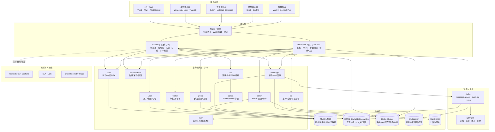

**分层说明**

| 层 | 职责 | 关键约束 |
| --- | --- | --- |
| 客户端层 | 交互、本地缓存、协议编解码 | 不产生权威状态；断网队列补发 |
| 接入层 | TLS、WSS、连接管理、路由、鉴权前置 | Gateway 无状态；API 网关承载全部 HTTP |
| 业务服务层 | 领域逻辑与持久化 | 服务间通过 gRPC 同步调用 + Kafka 异步解耦 |
| 消息与任务 | 削峰、扇出、异步索引、离线补偿 | 消费幂等，分区键 = `conversationId` 保序 |
| 存储层 | 结构化数据、消息、缓存、检索、文件 | 消息正文用宽表（按 `conv_id` 分区、`seq` 聚类），与业务库隔离 |
| 可观测 | 指标、日志、链路、告警 | `traceId` 从客户端贯穿到落库 |
| 媒体面 | 音视频媒体流（RTP/SRTP over UDP）在客户端与 SFU / TURN 之间直连，不经过 Gateway | SFU 与 TURN 按机房就近部署；媒体流与信令面故障隔离 |

> **部署形态选择**：中小规模（DAU < 2 万）可将 `Svc` 合并为一个 Go 二进制（模块化单体，`internal/<domain>` 分包），仅 Gateway 独立部署；达到容量阈值后按表拆分微服务，**协议与模块边界不变**，避免早期过度分布式。

---

## 3. 技术选型

| 层 / 端 | 选型 | 版本建议 | 理由 | 备选 |
| --- | --- | --- | --- | --- |
| 后端语言 | Go | 1.22+ | 高并发长连接、协程成本低、部署简单、跨平台编译 | — |
| HTTP 框架 | Gin | v1.10+ | 生态成熟、中间件丰富 | Hertz / Echo |
| WebSocket | `gorilla/websocket` | v1.5+ | 稳定、可控读泵写泵 | `nhooyr.io/websocket` |
| 内部 RPC | gRPC + Protobuf | — | 强类型、跨服务低延迟 | Go 直接函数调用（单体阶段） |
| 编解码 | Protobuf（WS 二进制帧），JSON（HTTP/调试） | proto3 | 省带宽、兼容演进 | 纯 JSON（MVP 可先用） |
| 消息队列 | Kafka | 3.x | 高吞吐、分区保序、可重放 | NATS JetStream / RocketMQ（lite 形态见 13.1） |
| 缓存 / 路由 | Redis Cluster | 7.x | 在线路由、`seq` 原子自增、幂等、限流 | 单实例 Redis（lite 形态见 13.1） |
| 业务库 | MySQL | 8.0 | 事务、RBAC 关系模型、运维成熟 | PostgreSQL（单机版见 13.1） |
| 消息库 | ScyllaDB（主选，兼容 Cassandra/CQL） | 2024.x | 宽表按 `conv_id` 分区 + `seq` 聚类，按会话时序范围读零跨分区；LSM 高写吞吐、按分区键线性扩容、TTL 自动过期；消息幂等不依赖数据库事务 | Cassandra / TiDB / MySQL 分表（中小规模兼容，见 8.4）；同实例单表（lite 见 13.1） |
| 检索 | Meilisearch | v1.x | 消息与审计全文检索，开箱即用、内置中文分词、低运维、毫秒级响应，与 lite 形态同引擎 | Elasticsearch / OpenSearch（超大规模 / 复杂聚合分析，见 8.4）；Typesense（lite 可选） |
| 对象存储 | MinIO（私有化）/ S3 兼容 | — | 分片上传、预签名 URL | 本地 FS / SeaweedFS（单机版见 13.1） |
| 配置/发现 | etcd 或 Nacos + Viper | — | 配置热更新、服务注册 | K8s ConfigMap；文件配置 + Viper（lite 见 13.1） |
| H5 | Vue 3 + TypeScript + Vite + Pinia + Vant | Vue 3.5 / Vite 5+ | 移动组件完备、构建快 | React + Ant Design Mobile |
| H5 本地缓存 | IndexedDB（Dexie） | — | 离线消息与草稿 | LocalStorage（仅配置） |
| 安卓原生客户端 | Kotlin + Jetpack Compose + Room + OkHttp | Kotlin 2.x / Compose | 原生性能、推送与通话系统能力完整 | Flutter（跨端复用 UI） |
| 苹果原生客户端 | Swift + SwiftUI + SQLite/GRDB + URLSession | Swift 5.9+ / iOS 14+ | 原生体验、CallKit / APNs 系统能力完整 | Flutter（跨端复用 UI） |
| 桌面客户端 | Electron + Vue 3（复用 H5 业务组件）+ better-sqlite3 | Electron 30+ | 三平台一致、生态成熟、无需 Rust 栈 | Tauri 2（体积更小，需 Rust） |
| 桌面打包 | electron-builder（NSIS / dmg / AppImage + deb/rpm） | — | 三平台安装包与自动更新 | — |
| 自动更新 | electron-updater + 自建更新服务 | — | 差分增量、签名校验、回滚 | — |
| 管理后台 | Vue 3 + TypeScript + Vite + Pinia + Vue Router + Element Plus + ECharts | — | 中后台组件与表格/权限生态完善 | Ant Design Vue |
| 鉴权 | JWT（RS256 / EdDSA）+ Redis 黑名单 | — | 无状态校验 + 可主动失效 |  opaque token |
| 密码哈希 | Argon2id（优先）/ bcrypt | — | 抗 GPU 爆破 | — |
| 网关 / 代理 | Nginx / Ingress | — | TLS 终止、WSS 升级、IP 限流 | Envoy |
| 容器与编排 | Docker + Kubernetes + Helm | 1.28+ | HPA、滚动升级、私有化交付 | Docker Compose（单机） |
| CI/CD | GitLab CI / GitHub Actions + Helm + ArgoCD | — | 镜像构建、五端打包（H5 / 桌面 / 安卓 / 苹果 / 后台）、灰度发布 | — |
| 可观测 | Prometheus + Grafana + Loki/ELK + OpenTelemetry + Jaeger | — | 指标/日志/链路三位一体 | VictoriaMetrics + Loki（lite 见 13.1） |
| 压测 | k6 / 自研 Go 压测客户端（长连接） | — | 模拟 10w 连接与消息洪峰 | — |
| 实时音视频 | WebRTC（浏览器 / Electron / 原生端内置 `RTCPeerConnection`） | M92+ / Electron 30+ / Android 8+ / iOS 14+ | 五端能力一致，无需自研采集编码 | 自研采集（成本高） |
| SFU 媒体服务器 | mediasoup（主选） | v3.14+ | 成熟稳定、Simulcast/SVC、文档与社区活跃、可容器化 | LiveKit（Go 栈统一、云原生）、Janus、ion-sfu；单节点/P2P 降级见 13.1 |
| TURN/STUN | coturn | 4.6+ | 标准兼容、可自建、支持长短期凭证 | 仅 STUN（无法保证穿透成功率） |
| 通话录制 | 自研录制服务（订阅 SFU RTP 落盘） | — | 与存储/权限/审计体系统一，可对接任意 SFU | 第三方云录制（私有化受限） |

**桌面端选型说明**：Electron 与 H5 共用 Vue 业务层，协议层、状态机、消息渲染只维护一份；原生能力通过 `preload` 暴露的受限 API（托盘、通知、快捷键、截图、文件、SQLite、更新）注入，业务层通过 `platform` 适配接口调用，H5 端提供同接口的浏览器降级实现。若后续对包体积/内存敏感，可平滑迁移 Tauri 2（Webview 层不变，Rust 侧重写原生适配）。

---

## 4. 后端服务设计

| 服务 | 主要职责 | 对外接口 | 主要存储 | 扩容方式 |
| --- | --- | --- | --- | --- |
| `gateway` | WSS 建连、鉴权、心跳、帧编解码、上行分发、下行推送、连接路由注册 | WSS `/ws` | Redis 路由表 | 无状态 HPA（连接数指标） |
| `api-gateway` | REST 路由、JWT 校验、RBAC 中间件、限流、参数校验、审计切面 | `/api/v1/**` | Redis | 无状态 HPA |
| `auth` | 登录、SSO/LDAP、令牌签发刷新、MFA、踢下线、设备列表 | gRPC + REST | MySQL + Redis | 无状态 |
| `user` | 用户资料、组织架构、部门树、状态、搜索 | gRPC + REST | MySQL + Meilisearch | 无状态 |
| `relation` | 好友申请、好友列表、黑名单 | gRPC + REST | MySQL + Redis | 无状态 |
| `conversation` | 会话创建/列表、未读计数、置顶、免打扰、草稿 | gRPC + REST | MySQL + Redis | 无状态 |
| `message` | 消息写入、`seq` 分配、幂等、漫游、撤回、已读、搜索 | gRPC + WSS 上行 | 宽表消息库 + Redis + Kafka + Meilisearch | 无状态（宽表按 `conv_id` 自动分区） |
| `group` | 群组、成员、角色、禁言、公告、审批 | gRPC + REST | MySQL + Redis | 无状态 |
| `file` | 上传初始化、分片、秒传、合并、下载签名、扫描回调 | REST | MinIO + MySQL | 无状态 / 可直传 |
| `admin` | RBAC、系统配置、敏感词、公告、审计日志、报表 | REST | MySQL + Redis + Meilisearch | 无状态 |
| `push` | 在线状态判定与下行选路：在线走长连接 `NOTICE_PUSH`，离线按设备 `push_channel / push_token` 选厂商通道（小米 / 华为 / OPPO / vivo）/ FCM / APNs；离线消息队列、桌面系统通知代理、公告定向推送、角标同步；处理推送回执与点击深链，失败重试（指数退避 + 死信）并落审计 | Kafka 消费 + REST（回执/深链） | Redis（在线路由/token）+ MySQL（`sys_device`/回执/审计） | 按分区扩容 |
| `job` | 消息归档清理、统计聚合、补偿对账、索引重建 | 定时任务 | 全存储 | 单实例 + 分布式锁 |
| `rtc` | 通话信令、房间与成员管理、SFU 编排、质量上报、录制调度、通话管控 | WSS 上行 + REST | MySQL + Redis + SFU/TURN | 无状态（按房间路由） |
| `turn` | coturn 集群：STUN 探测、TURN 中继、长短期凭证校验 | TURN 协议 | 无状态（凭证走 Redis） | 按机房多节点 |
| `recording` | 订阅 SFU RTP 流落盘、混音/合屏、转封装（MP4）、上传对象存储 | Kafka 消费 + REST | MinIO + MySQL | 无状态 |

### 4.1 Go 工程结构（模块化单体 / 微服务共用）

```
im-server/
├── cmd/
│   ├── gateway/          # 长连接接入
│   ├── api/              # HTTP API
│   ├── message/          # 消息服务（拆分后独立二进制）
│   └── job/              # 定时任务
├── internal/
│   ├── domain/           # 领域模型与接口（auth/user/message/group/rbac...）
│   ├── service/          # 业务用例编排
│   ├── repository/       # MySQL / Redis / 宽表 / Meilisearch / OSS 实现
│   ├── protocol/         # protobuf 帧、命令字、错误码
│   ├── middleware/       # JWT / RBAC / 限流 / 审计 / trace
│   └── pkg/              # 通用库：snowflake、pool、ringbuffer、config
├── api/proto/            # *.proto
├── configs/              # config.yaml + 环境变量覆盖
├── deployments/          # Dockerfile / helm chart / docker-compose
└── scripts/              # 迁移、压测、运维脚本
```

---

## 5. 客户端架构

### 5.1 H5 端

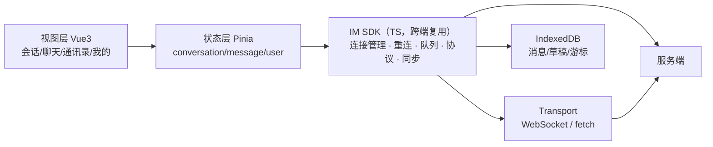

**IM SDK 核心状态机**：`idle → connecting → authing → syncing → online → reconnecting → offline`。
关键能力：指数退避重连（1s→30s + 抖动）、上行队列（按 `clientMsgId` 幂等）、`since_seq` 增量同步、心跳 30s + 超时 90s、前台切换立即同步、消息按 `seq` 排序去重、离线可渲染本地缓存。

### 5.2 桌面客户端

| 层 | 技术 | 说明 |
| --- | --- | --- |
| 渲染进程 | Vue 3 + 复用 H5 业务组件 + IM SDK | 三栏布局，独立于 H5 的桌面交互壳 |
| 预加载层 | `preload.js` + contextBridge | 白名单式暴露 `window.desktop.*` 原生 API |
| 主进程 | Electron Main | 窗口/托盘/快捷键/通知/更新/深链/单实例锁 |
| 原生模块 | better-sqlite3（SQLCipher）、截图、文件拖拽 | 本地加密消息缓存、冷启动秒开 |
| 更新 | electron-updater | 差分更新、签名校验、失败回滚 |

原生 API 抽象：`notify` / `trayBadge` / `shortcut` / `captureScreen` / `pickFile` / `db` / `appVersion` / `autoLaunch`。H5 端同名接口返回浏览器降级实现（Notification API、IndexedDB、`<input type=file>` 等），**业务代码零分支**。

### 5.3 移动端原生客户端（Android / iOS）

| 层 | 安卓（Android 8.0+） | 苹果（iOS 14+） |
| --- | --- | --- |
| UI | Kotlin + Jetpack Compose（Material 3） | Swift + SwiftUI（人机界面指南） |
| 本地存储 | Room + SQLCipher（消息 / 草稿 / 游标） | SQLite/GRDB 加密（消息 / 草稿 / 游标） |
| 网络 | OkHttp WebSocket + Retrofit | URLSession WebSocket |
| 推送 | 厂商通道（小米 / 华为 / OPPO / vivo）+ FCM 双通道 | APNs（通知按会话分组） |
| 通话 | WebRTC + 系统来电界面（ConnectionService） | WebRTC + CallKit（锁屏接听 / 画中画） |
| 更新 | 应用市场 / 应用内差分下载（授权安装） | App Store / 企业分发 |

**要点**：
1. 复用 IM SDK 状态机与多端同步协议（`clientMsgId` 幂等、`since_seq` 增量同步、心跳保活），仅替换原生适配层：推送通道注册、权限申请、角标同步、深链跳转、画中画；
2. 推送链路：推送服务按设备在线状态选路——在线走长连接 `NOTICE_PUSH`，离线走厂商通道 / APNs；点击推送深链直达对应会话，来电走系统来电界面（FR-APP-02/07）；
3. 权限模型：通知 / 麦克风 / 摄像头 / 相册 / 蓝牙按需申请，拒绝后功能优雅降级并引导系统设置（FR-APP-04）；
4. 角标 = 服务端未读总数（`badge` 随推送下发），锁屏预览支持隐私模式（FR-APP-03）；后台保活与冷启动增量同步 ≤3s（FR-APP-05）。

### 5.4 Vue 管理后台 RBAC 前端方案

```
登录 → 获取 token + permissions[] + dataScope
     → filterRoutes(asyncRoutes, permissions) → router.addRoute()
     → 菜单由已注册路由生成（不手写菜单）
     → 按钮用 v-permission 指令按权限码显隐
     → 请求拦截器注入 token / traceId / nonce
     → 响应拦截器统一处理 401/403/业务错误码
```

`permissions` 形如 `user:list`、`user:disable`、`rbac:role:grant`、`audit:message:export`；权限码与后端接口权限表一一对应，避免前后端两套清单漂移。

---

## 6. 通信协议设计

### 6.1 传输与帧格式

- H5 / 桌面统一 `wss://<host>/ws?token=...&device=H5|DESKTOP&v=1`；帧为 Protobuf 二进制（MVP 可切 JSON，通过帧头 `codec` 字段协商）。
- 管理后台走 HTTPS REST + JSON；仅少量实时提醒（在线数刷新）使用 SSE，避免后台引入长连接复杂度。

```protobuf
syntax = "proto3";
package im.protocol.v1;

message Frame {
  string trace_id      = 1;  // 全链路追踪
  Command cmd          = 2;  // 命令字
  uint64 seq_no        = 3;  // 客户端请求序号，用于请求-响应匹配
  int32  code          = 4;  // 0 = 成功，其余见错误码表
  string message       = 5;  // 错误描述
  bytes  payload       = 6;  // 按 cmd 反序列化
  int64  server_time   = 7;
}

message SendMessageReq {
  string client_msg_id = 1;  // UUID，幂等键
  string conv_id       = 2;
  ConvType conv_type   = 3;  // SINGLE / GROUP / SYSTEM
  string to_uid        = 4;
  ContentType type     = 5;  // TEXT/IMAGE/VIDEO/VOICE/FILE/DOC/LOCATION/CARD/CALL/REVOKE
  bytes  content       = 6;  // JSON 或压缩后的结构化内容
  string extra         = 7;  // @列表、引用消息ID、e2ee 标记
}

message SendMessageAck {
  string client_msg_id = 1;
  string msg_id        = 2;  // 服务端雪花ID
  uint64 seq           = 3;  // 会话内单调递增
  int64  send_time     = 4;
}

message PushMessage {
  string msg_id = 1;
  string conv_id = 2;
  uint64 seq = 3;
  string from_uid = 4;
  ContentType type = 5;
  bytes content = 6;
  int64 send_time = 7;
}
```

### 6.2 命令字表

| cmd | 方向 | 说明 |
| --- | --- | --- |
| `AUTH` / `AUTH_ACK` | C→S / S→C | 建连鉴权，返回用户信息、最大 `seq`、离线数量 |
| `HEARTBEAT` / `HEARTBEAT_ACK` | 双向 | 30s 心跳，携带客户端时间用于时钟偏移估算 |
| `SEND` / `SEND_ACK` | C→S / S→C | 发消息，ACK 内含 `msgId` + `seq` |
| `PUSH` / `PUSH_ACK` | S→C / C→S | 下行消息 / 送达确认 |
| `SYNC` / `SYNC_ACK` | C→S / S→C | 按 `since_seq` + 会话维度增量拉取，支持批量分页 |
| `READ` / `READ_ACK` | 双向 | 上报最大连续已读 `seq`，广播给发送方所有端 |
| `REVOKE` / `REVOKE_PUSH` | 双向 | 撤回通知（原消息替换为 tombstone） |
| `TYPING` | 双向 | 输入中，3s 节流、不落库 |
| `PRESENCE_PUSH` | S→C | 好友在线状态变更 |
| `KICK` | S→C | 互踢 / 管理员禁用 / token 失效，携带原因码 |
| `NOTICE_PUSH` | S→C | 系统通知、公告、入群/好友申请 |

### 6.3 消息体示例（文本）

```json
{
  "text": "下午三点评审架构方案",
  "mentions": ["u_10086"],
  "quoteMsgId": "m_739...",
  "atAll": false
}
```

文件类消息含 `fileId / name / size / mime / thumb / duration / hash`，下载前先用 `fileId` 换取预签名 URL。

### 6.4 REST API 约定

| 方法 | 路径 | 权限码 | 说明 |
| --- | --- | --- | --- |
| POST | `/api/v1/auth/login` | 匿名 | 登录，返回双令牌 |
| POST | `/api/v1/auth/refresh` | 匿名 | 刷新令牌 |
| GET | `/api/v1/auth/permissions` | 登录 | 返回菜单树 + 权限码 + 数据范围 |
| GET | `/api/v1/conversations` | `conv:list` | 会话列表（分页） |
| GET | `/api/v1/conversations/{id}/messages` | `message:list` | 历史消息（游标分页） |
| POST | `/api/v1/messages/revoke` | `message:revoke` | 撤回 |
| GET | `/api/v1/users` | `user:list` | 用户列表（受数据范围约束） |
| PATCH | `/api/v1/users/{id}/status` | `user:disable` | 启用/禁用 |
| GET | `/api/v1/admin/roles` | `rbac:role:list` | 角色列表 |
| PUT | `/api/v1/admin/roles/{id}/permissions` | `rbac:role:grant` | 授权（写审计） |
| GET | `/api/v1/admin/audit/messages` | `audit:message:list` | 消息审计检索 |
| POST | `/api/v1/admin/audit/export` | `audit:message:export` | 导出（MFA 二次校验） |
| GET | `/api/v1/admin/dashboard` | `dashboard:view` | 仪表盘聚合指标 |

**按域完整接口清单**（与网关权限中间件注册表一一对应）：

| 域 | 接口 |
| --- | --- |
| 认证 | `POST /auth/register`（注册即登录）、`POST /auth/sms-code`（限流 60s/次、10 次/日）、`POST /auth/login`、`POST /auth/login-by-code`、`POST /auth/refresh`、`POST /auth/logout`、`POST /auth/password/forgot`、`GET /auth/permissions`、`GET /auth/devices`、`POST /auth/devices/bind`（推送 token 绑定：platform + channel + token）、`DELETE /auth/devices/{deviceId}` |
| 用户与组织 | `GET /users/search`（手机号 / 昵称 / 部门，P95 ≤ 300ms）、`GET/POST /users`、`GET/PUT /users/{id}`、`PATCH /users/{id}/status`、`POST /users/{id}/reset-password`、`GET /users/{id}/profile`、`GET/POST/PUT/DELETE /depts`、`GET /depts/tree` |
| 好友关系 | `GET /friends`、`POST /friends/apply`、`GET /friends/applies`（待处理/已处理）、`PUT /friends/applies/{id}`（同意/拒绝）、`DELETE /friends/{uid}`、`POST /blocks`、`GET/DELETE /blocks` |
| 会话 | `GET /conversations`、`PATCH /conversations/{id}/settings`（置顶/免打扰）、`POST /conversations/read-all`（一键已读）、`DELETE /conversations/{id}/messages`（清空本地记录游标）、`GET /reminds`（提醒我列表） |
| 消息 | `GET /conversations/{id}/messages`、`POST /messages/revoke`、`POST /messages/delete`、`POST /messages/forward`（多目标 + 附言）、`POST /messages/search`、`POST /messages/read` |
| 群组 | `GET/POST /groups`、`GET/PUT/DELETE /groups/{id}`、`POST /groups/{id}/members`、`DELETE /groups/{id}/members/{uid}`、`PUT /groups/{id}/members/{uid}/role`、`POST /groups/{id}/mute`、`PUT /groups/{id}/notice`、`POST /groups/{id}/transfer` |
| 文件 | `POST /files/init`（秒传探测/分片初始化）、`PUT /files/{id}/parts/{n}`、`POST /files/{id}/complete`、`GET /files/{id}/download-url` |
| 音视频 | `POST /rtc/call`（发起/房间创建）、`POST /rtc/call/{id}/accept|reject|bye`、`GET /rtc/records`、`GET /rtc/records/{id}/playback`、`GET /rtc/quality`、`POST /rtc/force-end` |
| 管理后台 | `GET /admin/roles`、`POST/PUT/DELETE /admin/roles`、`PUT /admin/roles/{id}/permissions`、`GET /admin/users`（数据范围注入）、`GET /admin/audit/messages`、`POST /admin/audit/export`、`GET /admin/logs`、`GET/POST/PUT/DELETE /admin/notices`（公告管理）、`PATCH /admin/notices/{id}/offline`、`GET /admin/notices/{id}/read-stats`、`GET/PUT /admin/settings` |

统一响应：

```json
{ "code": 0, "message": "ok", "data": {}, "traceId": "8f3c...", "serverTime": 1763193600000 }
```

### 6.5 错误码分段

| 区间 | 含义 | 示例 |
| --- | --- | --- |
| `0` | 成功 | — |
| `1xxx` | 参数/协议 | `1001` 帧格式错误、`1002` 不支持的命令字 |
| `2xxx` | 认证 | `2001` token 过期、`2002` 被踢下线、`2003` 账号禁用 |
| `3xxx` | 权限 | `3001` 接口未授权、`3002` 数据范围越界、`3003` MFA 未通过 |
| `4xxx` | 业务 | `4001` 不是好友、`4002` 已被拉黑、`4003` 群已满、`4004` 禁言中、`4005` 敏感词拦截、`4006` 撤回超时 |
| `5xxx` | 限流/容量 | `5001` 发送过频、`5002` 文件超限 |
| `9xxx` | 系统 | `9001` 存储不可用、`9002` 内部错误 |

---

### 6.6 音视频信令（RTC）

信令面复用 IM WebSocket 通道（`cmd` 新增 RTC 段），媒体面独立走 UDP/SRTP，二者故障隔离。房间令牌由 `rtc` 服务签发，SFU 与 TURN 校验同一密钥。

| cmd | 方向 | 说明 |
| --- | --- | --- |
| `CALL_INVITE` / `CALL_RING` | C→S / S→C | 发起呼叫 / 对端振铃（携带通话类型、房间号、超时时间） |
| `CALL_ACCEPT` / `CALL_REJECT` | C→S / S→C | 接听 / 拒绝（携带原因：busy / decline / offline） |
| `CALL_CANCEL` / `CALL_BYE` | C→S / S→C | 主叫取消 / 任一方挂断（携带原因与通话统计） |
| `CALL_SDP` / `CALL_CANDIDATE` | 双向 | SDP offer/answer 与 ICE candidate 经服务端中转 |
| `CALL_MUTE` / `CALL_CAMERA` / `CALL_SPEAKER` | 双向 | 麦克风 / 摄像头 / 扬声器（听筒、免提）状态变更 |
| `CALL_SWITCH` | 双向 | 语音 ↔ 视频切换（重新协商 SDP） |
| `CALL_SHARE_START` / `CALL_SHARE_STOP` | C→S / S→C | 屏幕共享开始 / 停止 |
| `CALL_FORCE_END` | S→C | 后台强制挂断或权限管控（携带原因） |
| `CALL_PUSH` | S→C | 推送被叫端，按设备优先级仅推主端 |
| `RTC_QUALITY` | C→S | 客户端周期性上报质量（MOS、丢包率、码率、卡顿） |

房间令牌（JWT）：

```json
{
  "iss": "rtc",
  "roomId": "r_7391a2c4",
  "uid": "u_10086",
  "role": "member",
  "canPublish": ["audio", "video"],
  "canSubscribe": true,
  "exp": 1763197200
}
```

**连通性策略**：1v1 优先 P2P（STUN 探测直连），探测失败或对称 NAT 回落 TURN 中继；群组通话强制走 SFU。所有失败路径均降级为可通话状态（视频降语音、语音回落消息提示），不允许出现「无提示的静默失败」。

---

## 7. 核心流程时序

### 7.0 登录、建连与多端互踢（对应 FR-AUTH-03/04/06）

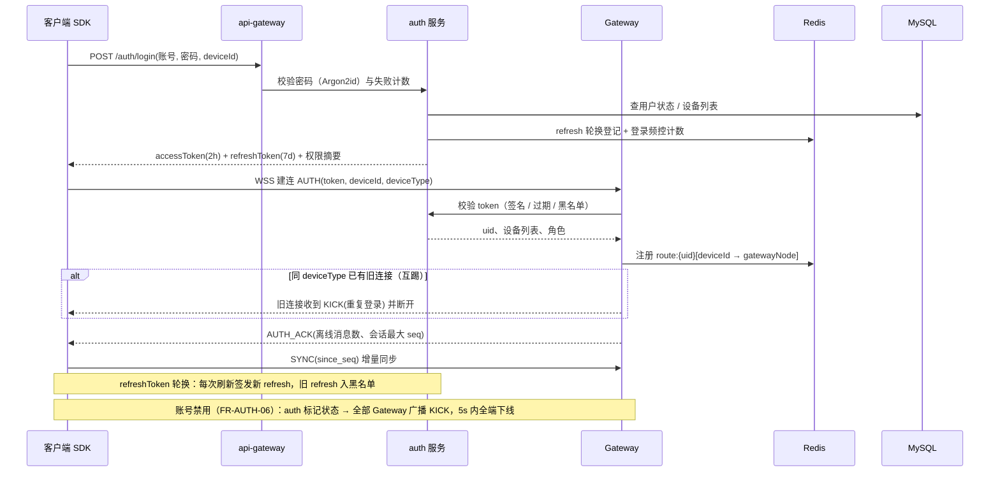

**要点**：双令牌 `accessToken` 2h / `refreshToken` 7d（轮换 + Redis 黑名单，支持主动失效）；同 `deviceType` 互踢、异类设备共存、最大在线数可配置；登录失败 5 次锁定 10 分钟（FR-AUTH-01），管理员登录附加 MFA。

### 7.1 消息发送（含可靠性闭环）

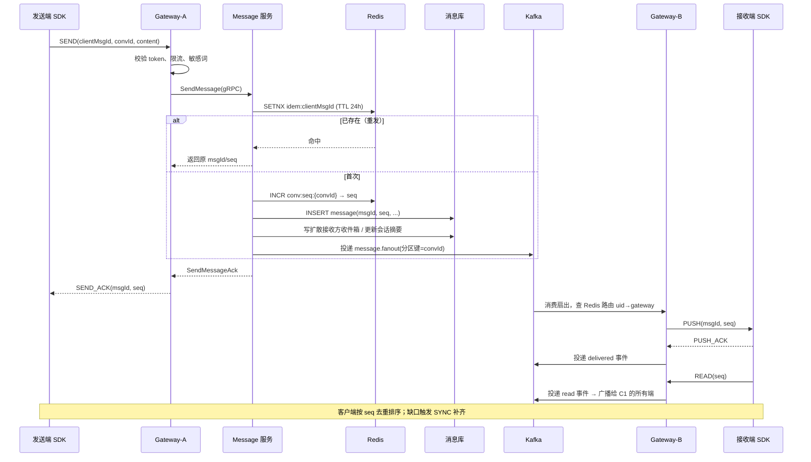

### 7.2 离线与多端同步

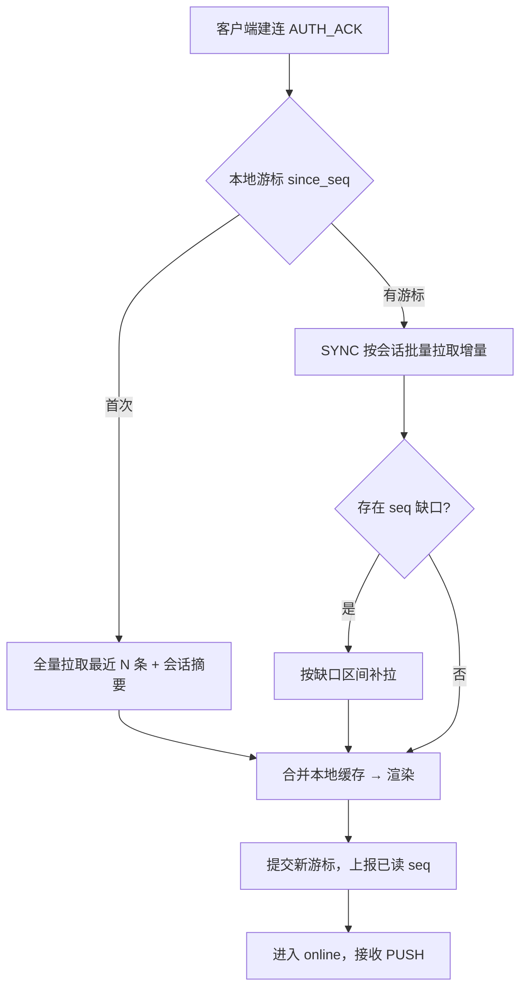

多端同步规则：同一 `uid` 的每个 `deviceId` 独立维护 `since_seq`；服务端推送到该 `uid` 的全部在线连接；已读状态取各端上报的最大值且**不回退**；互踢只作用于同 `deviceType` 的最旧连接。

### 7.3 RBAC 鉴权

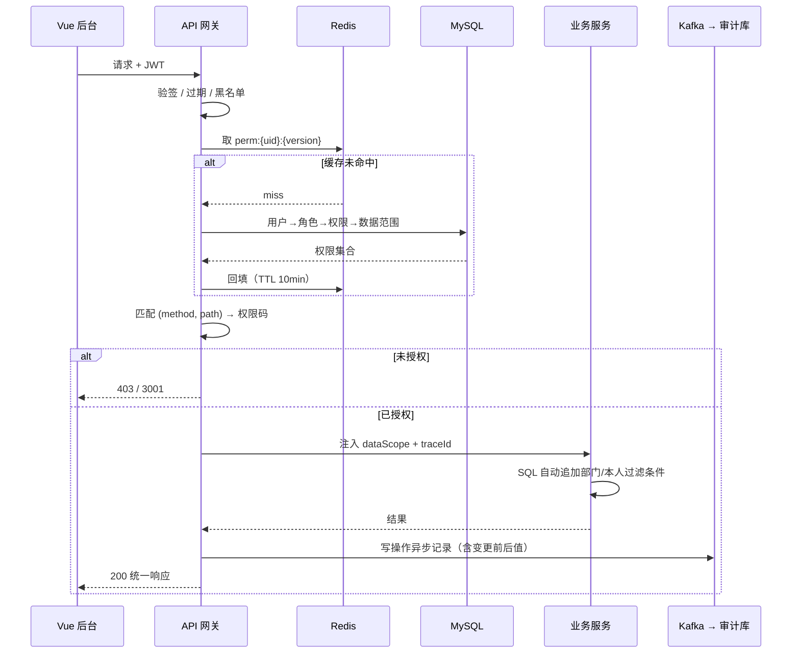

---

### 7.4 1v1 通话建立（P2P 优先，失败回落 TURN）

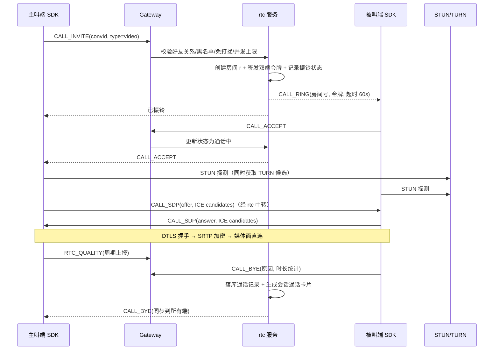

### 7.5 群组通话（SFU 转发）

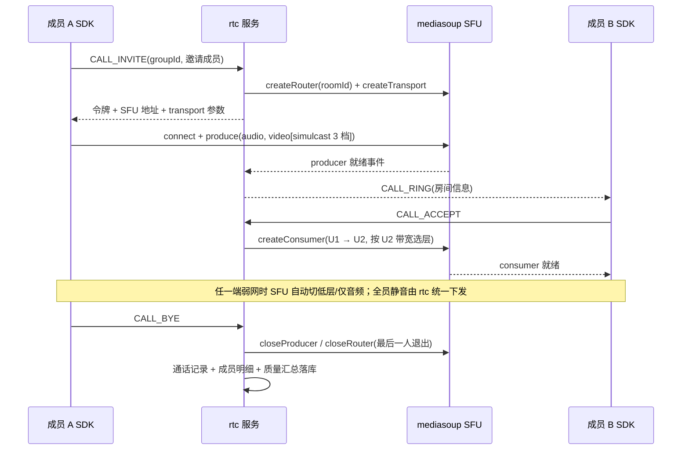

---

### 7.6 富媒体消息上传与发送

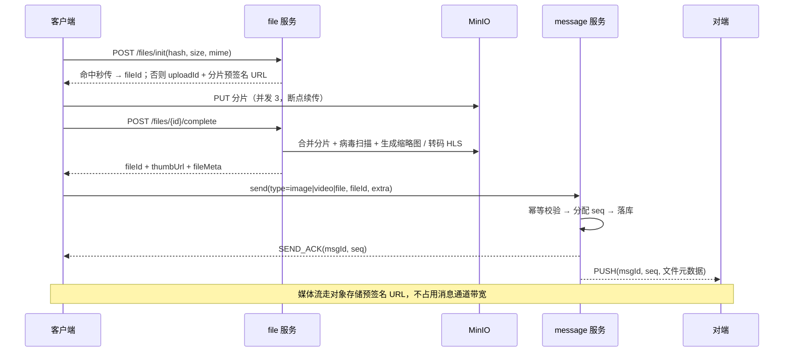

**多端同步游标**：每个 `deviceId` 独立保存 `since_seq`；发送端收到 `SEND_ACK` 后即更新本地游标，其他端通过 `PUSH` 或 `SYNC` 追平；客户端展示「同步中 / 已同步 / N 端在线」三态，检测到缺口立即按会话批量补拉。

---

## 8. 数据存储设计

### 8.0 核心实体关系（ER 图）

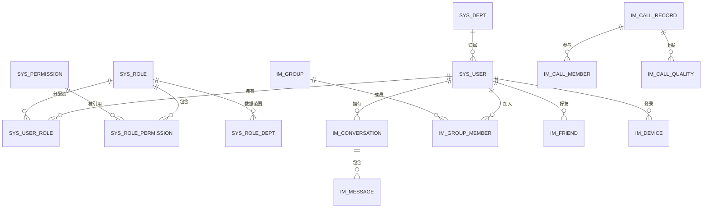

### 8.1 业务库核心表（MySQL 8.0）

```sql
-- 用户与组织
CREATE TABLE sys_user (
  id            BIGINT PRIMARY KEY AUTO_INCREMENT,
  uid           VARCHAR(32)  NOT NULL UNIQUE COMMENT '业务用户ID',
  username      VARCHAR(64)  NOT NULL UNIQUE,
  password_hash VARCHAR(128) NOT NULL,
  nickname      VARCHAR(64)  NOT NULL,
  avatar        VARCHAR(256) DEFAULT '',
  mobile        VARBINARY(128) DEFAULT NULL COMMENT '加密存储',
  email         VARBINARY(256) DEFAULT NULL COMMENT '加密存储',
  dept_id       BIGINT       NOT NULL DEFAULT 0,
  status        TINYINT      NOT NULL DEFAULT 1 COMMENT '1正常 2禁用 3注销',
  last_login_at BIGINT       DEFAULT 0,
  created_at    BIGINT       NOT NULL,
  updated_at    BIGINT       NOT NULL,
  INDEX idx_dept (dept_id), INDEX idx_nickname (nickname)
) ENGINE=InnoDB DEFAULT CHARSET=utf8mb4;

CREATE TABLE sys_dept (
  id        BIGINT PRIMARY KEY AUTO_INCREMENT,
  parent_id BIGINT NOT NULL DEFAULT 0,
  name      VARCHAR(64) NOT NULL,
  path      VARCHAR(512) NOT NULL COMMENT '物化路径 /1/3/9/，用于数据范围过滤',
  sort      INT DEFAULT 0,
  INDEX idx_parent (parent_id), INDEX idx_path (path(191))
) ENGINE=InnoDB DEFAULT CHARSET=utf8mb4;

-- RBAC 五张核心表
CREATE TABLE sys_role (
  id          BIGINT PRIMARY KEY AUTO_INCREMENT,
  code        VARCHAR(64) NOT NULL UNIQUE COMMENT '如 OPS_ADMIN',
  name        VARCHAR(64) NOT NULL,
  parent_id   BIGINT DEFAULT 0 COMMENT '角色继承',
  data_scope  TINYINT NOT NULL DEFAULT 4 COMMENT '1全部 2本部门及下级 3本部门 4仅本人 5自定义',
  builtin     TINYINT DEFAULT 0 COMMENT '内置角色不可删除',
  status      TINYINT DEFAULT 1,
  remark      VARCHAR(256) DEFAULT '',
  version     INT DEFAULT 1 COMMENT '权限版本号，用于缓存失效'
) ENGINE=InnoDB DEFAULT CHARSET=utf8mb4;

CREATE TABLE sys_permission (
  id        BIGINT PRIMARY KEY AUTO_INCREMENT,
  parent_id BIGINT NOT NULL DEFAULT 0,
  code      VARCHAR(96) NOT NULL UNIQUE COMMENT 'user:disable / rbac:role:grant',
  name      VARCHAR(64) NOT NULL,
  type      TINYINT NOT NULL COMMENT '1目录 2菜单 3接口 4按钮',
  method    VARCHAR(10) DEFAULT '' COMMENT '接口类：GET/POST/...',
  path      VARCHAR(200) DEFAULT '' COMMENT '接口路径或前端路由',
  sort      INT DEFAULT 0
) ENGINE=InnoDB DEFAULT CHARSET=utf8mb4;

CREATE TABLE sys_user_role (
  user_id BIGINT NOT NULL, role_id BIGINT NOT NULL,
  PRIMARY KEY (user_id, role_id)
) ENGINE=InnoDB;

CREATE TABLE sys_role_permission (
  role_id BIGINT NOT NULL, perm_id BIGINT NOT NULL,
  PRIMARY KEY (role_id, perm_id)
) ENGINE=InnoDB;

CREATE TABLE sys_role_dept (
  role_id BIGINT NOT NULL, dept_id BIGINT NOT NULL,
  PRIMARY KEY (role_id, dept_id)
) ENGINE=InnoDB COMMENT 'data_scope=5 自定义部门集合';

CREATE TABLE sys_audit_log (
  id          BIGINT PRIMARY KEY AUTO_INCREMENT,
  operator_id BIGINT NOT NULL,
  operator_ip VARCHAR(64) NOT NULL,
  module      VARCHAR(64) NOT NULL,
  action      VARCHAR(64) NOT NULL,
  target      VARCHAR(128) DEFAULT '',
  before_val  JSON DEFAULT NULL,
  after_val   JSON DEFAULT NULL,
  result      TINYINT NOT NULL,
  trace_id    VARCHAR(64) NOT NULL,
  created_at  BIGINT NOT NULL,
  INDEX idx_op (operator_id, created_at), INDEX idx_trace (trace_id)
) ENGINE=InnoDB COMMENT '仅追加，禁止 UPDATE/DELETE';

-- 验证码：仅存哈希，一次性使用，60s 频控与每日上限由 Redis 计数
CREATE TABLE sys_verify_code (
  id         BIGINT PRIMARY KEY AUTO_INCREMENT,
  target     VARCHAR(64) NOT NULL COMMENT '手机号 / 邮箱（加密或哈希后索引）',
  scene      VARCHAR(32) NOT NULL COMMENT 'register / login / reset',
  code_hash  VARCHAR(128) NOT NULL,
  expire_at  BIGINT NOT NULL,
  used       TINYINT NOT NULL DEFAULT 0,
  created_at BIGINT NOT NULL,
  INDEX idx_target (target, scene, created_at)
) ENGINE=InnoDB;

-- 登录设备与推送 token（FR-AUTH-07 设备管理 / FR-APP-02 离线推送选路）
CREATE TABLE sys_device (
  id           BIGINT PRIMARY KEY AUTO_INCREMENT,
  uid          BIGINT NOT NULL,
  device_id    VARCHAR(64) NOT NULL,
  platform     VARCHAR(16) NOT NULL COMMENT 'H5 / DESKTOP / ANDROID / IOS',
  device_name  VARCHAR(64) DEFAULT '',
  push_channel VARCHAR(24) DEFAULT '' COMMENT '空 = 不推送；FCM / MIUI / HUAWEI / OPPO / VIVO / APNs',
  push_token   VARCHAR(256) DEFAULT '',
  last_active  DATETIME NOT NULL DEFAULT CURRENT_TIMESTAMP ON UPDATE CURRENT_TIMESTAMP,
  created_at   DATETIME NOT NULL DEFAULT CURRENT_TIMESTAMP,
  UNIQUE KEY uk_device (uid, device_id),
  INDEX idx_token (push_channel, push_token(64))
) ENGINE=InnoDB;
```

### 8.2 IM 核心表

```sql
CREATE TABLE im_conversation (
  id           BIGINT PRIMARY KEY AUTO_INCREMENT,
  conv_id      VARCHAR(64) NOT NULL UNIQUE,
  conv_type    TINYINT NOT NULL COMMENT '1单聊 2群聊 3系统',
  owner_uid    VARCHAR(32) NOT NULL COMMENT '会话拥有者（写扩散维度）',
  peer_id      VARCHAR(64) NOT NULL,
  max_seq      BIGINT NOT NULL DEFAULT 0,
  read_seq     BIGINT NOT NULL DEFAULT 0,
  unread       INT NOT NULL DEFAULT 0,
  pinned       TINYINT DEFAULT 0,
  muted        TINYINT DEFAULT 0,
  last_msg_id  VARCHAR(64) DEFAULT '',
  last_msg_at  BIGINT DEFAULT 0,
  UNIQUE KEY uk_owner_peer (owner_uid, peer_id),
  INDEX idx_owner_last (owner_uid, pinned, last_msg_at)
) ENGINE=InnoDB;

-- 消息表（MySQL 兼容方案，中小规模 / lite 形态使用）：按 conv_id 哈希分库分表，分片键与 Kafka 分区键一致；
-- 标准版以宽表为主选，分区键 conv_id + 聚类键 seq 的设计见 8.4，本表 DDL 保留供兼容部署与迁移回退
CREATE TABLE im_message_0000 (
  id           BIGINT PRIMARY KEY COMMENT '雪花ID',
  msg_id       VARCHAR(64) NOT NULL UNIQUE,
  conv_id      VARCHAR(64) NOT NULL,
  seq          BIGINT NOT NULL,
  from_uid     VARCHAR(32) NOT NULL,
  to_id        VARCHAR(64) NOT NULL,
  type         TINYINT NOT NULL,
  content      MEDIUMBLOB NOT NULL,
  extra        JSON DEFAULT NULL,
  client_msg_id VARCHAR(64) NOT NULL,
  status       TINYINT DEFAULT 1 COMMENT '1正常 2撤回 3删除',
  created_at   BIGINT NOT NULL,
  UNIQUE KEY uk_conv_seq (conv_id, seq),
  UNIQUE KEY uk_client (from_uid, client_msg_id),
  INDEX idx_conv_time (conv_id, created_at)
) ENGINE=InnoDB;

CREATE TABLE im_group (
  id        BIGINT PRIMARY KEY AUTO_INCREMENT,
  group_id  VARCHAR(64) NOT NULL UNIQUE,
  name      VARCHAR(128) NOT NULL,
  owner_uid VARCHAR(32) NOT NULL,
  avatar    VARCHAR(256) DEFAULT '',
  notice    VARCHAR(1024) DEFAULT '',
  max_member INT DEFAULT 500,
  status    TINYINT DEFAULT 1 COMMENT '1正常 2冻结 3解散',
  created_at BIGINT NOT NULL
) ENGINE=InnoDB;

CREATE TABLE im_group_member (
  group_id  VARCHAR(64) NOT NULL,
  uid       VARCHAR(32) NOT NULL,
  role      TINYINT NOT NULL COMMENT '1群主 2管理员 3成员',
  muted_until BIGINT DEFAULT 0,
  joined_at BIGINT NOT NULL,
  PRIMARY KEY (group_id, uid), INDEX idx_uid (uid)
) ENGINE=InnoDB;

CREATE TABLE im_device (
  id         BIGINT PRIMARY KEY AUTO_INCREMENT,
  uid        VARCHAR(32) NOT NULL,
  device_id  VARCHAR(64) NOT NULL UNIQUE,
  device_type TINYINT NOT NULL COMMENT '1 H5 2 Windows 3 macOS 4 Linux',
  gateway    VARCHAR(64) DEFAULT '',
  last_active BIGINT DEFAULT 0,
  INDEX idx_uid (uid)
) ENGINE=InnoDB;

-- 好友关系（双向各存一行，好友操作在事务中成对写入）
CREATE TABLE im_friend (
  uid        VARCHAR(32) NOT NULL,
  friend_uid VARCHAR(32) NOT NULL,
  remark     VARCHAR(64) DEFAULT '' COMMENT '我对好友的备注',
  group_tag  VARCHAR(32) DEFAULT '' COMMENT '好友分组',
  status     TINYINT NOT NULL DEFAULT 1 COMMENT '1正常 2已删除',
  created_at BIGINT NOT NULL,
  PRIMARY KEY (uid, friend_uid), INDEX idx_friend (friend_uid)
) ENGINE=InnoDB;

CREATE TABLE im_friend_apply (
  id         BIGINT PRIMARY KEY AUTO_INCREMENT,
  from_uid   VARCHAR(32) NOT NULL,
  to_uid     VARCHAR(32) NOT NULL,
  message    VARCHAR(256) DEFAULT '' COMMENT '申请留言',
  source     VARCHAR(32) DEFAULT '' COMMENT '来源：search / group / card',
  status     TINYINT NOT NULL DEFAULT 0 COMMENT '0待处理 1已同意 2已拒绝 3已过期(7天)',
  handled_at BIGINT DEFAULT 0,
  created_at BIGINT NOT NULL,
  INDEX idx_to (to_uid, status), INDEX idx_from (from_uid, created_at)
) ENGINE=InnoDB;

CREATE TABLE im_block (
  uid        VARCHAR(32) NOT NULL,
  block_uid  VARCHAR(32) NOT NULL,
  created_at BIGINT NOT NULL,
  PRIMARY KEY (uid, block_uid)
) ENGINE=InnoDB COMMENT '黑名单，写入时同步删除好友关系';
```

### 8.3 Redis Key 设计

| Key | 类型 | 用途 | TTL |
| --- | --- | --- | --- |
| `route:{uid}` | Hash | `deviceId → gatewayNode` 在线路由 | 心跳续期 120s |
| `conv:seq:{convId}` | String | 会话内 `seq` 原子自增 | 永久（与会话同生命周期） |
| `idem:{clientMsgId}` | String | 发送幂等，值 = `msgId` | 24h |
| `perm:{uid}:{version}` | Set | 用户权限码集合 | 10min，角色变更主动删除 |
| `token:blacklist:{jti}` | String | 主动失效令牌 | 剩余有效期 |
| `offline:{uid}:{convId}` | ZSet | 离线消息索引（score = seq） | 7d 或消费完 |
| `unread:{uid}:{convId}` | Hash | 未读计数与已读游标 | 永久 |
| `limit:send:{uid}` | String | 发送频率限流（滑动窗口） | 60s |
| `sensitive:words:v{N}` | Set | 敏感词版本号与词库快照 | 版本号控制 |
| `lock:job:{name}` | String | 分布式任务锁 | 任务周期 |
| `conv:setting:{uid}:{convId}` | Hash | 会话设置：`pinned` / `muted`，多端同步源 | 永久 |
| `friend:apply:{uid}` | ZSet | 待处理好友申请索引（score = 申请时间） | 7d |
| `notice:read:{noticeId}` | HyperLogLog | 公告已读用户数（估算，误差 < 1%） | 公告有效期 |
| `remind:{uid}` | ZSet | 「提醒我」聚合索引（@我 / 引用我，score = seq） | 30d |
| `sms:limit:{target}` | String | 验证码发送频控（同目标 60s 一次） | 60s |
| `sms:daily:{target}` | String | 验证码每日发送计数（10 次/日） | 24h |
| `rtc:node:{roomId}` | String | 通话房间 → SFU / TURN 节点选择结果 | 通话期间 |
| `rtc:call:{callId}` | Hash | 通话状态机（呼叫中/振铃/通话中）与多端振铃记录 | 24h |

### 8.4 消息宽表设计与检索

消息存储是 IM 的核心，访问模式为「高吞吐追加写 + 按会话时序范围读」，与宽表数据库高度契合。标准版以 **ScyllaDB（兼容 Cassandra/CQL）** 为主选；中小规模与 lite 形态用 MySQL 分表/单表（见 8.2 与 13.1），同一套 `message` 服务接口屏蔽底层差异。

**为何选宽表**：① 分区键 `conv_id` 把单会话消息物理聚簇，漫游/增量同步按 `conv_id + seq` 范围扫描即可，**零跨分区查询**；② LSM 引擎顺序写，写吞吐远高于 B+ 树随机写；③ 按分区键一致性哈希自动分片，**无固定分片数**，扩容无需业务层重写路由与数据迁移；④ 字段级 **TTL** 原生过期，消息留存到点自动清理，无需 `job` 划窗删除与碎片整理；⑤ 多副本 + 可配一致性级别实现高可用与跨机房。消息幂等由 `client_msg_id` + Redis + `seq` 保证，**不依赖数据库事务**，因此选 MySQL 的主要理由（事务）在本场景不成立。

**CQL 建表**（分区键 `conv_id`，聚类列 `seq` 降序，TTL 与 TWCS 压缩）：

```sql
CREATE KEYSPACE im WITH replication = {'class':'NetworkTopologyStrategy','dc1':3};

CREATE TABLE im.message_by_conv (
  conv_id       text,
  bucket        int,          -- 时间桶：floor(created_at / 86400000)，配合 TWCS 做时间窗压缩
  seq           bigint,
  msg_id        text,
  from_uid      text,
  to_id         text,
  type          tinyint,
  content       blob,         -- Protobuf 编码正文，敏感字段加密
  extra         text,         -- JSON 扩展
  client_msg_id text,
  status        tinyint,      -- 1正常 2撤回 3删除
  created_at    bigint,
  PRIMARY KEY ((conv_id, bucket), seq)
) WITH CLUSTERING ORDER BY (seq DESC)
  AND compaction = {'class':'TimeWindowCompactionStrategy',
                    'compaction_window_unit':'DAYS','compaction_window_size':1}
  AND default_time_to_live = 15552000;   -- 180 天，按留存配置下发
```

- **分区键设计**：`(conv_id, bucket)` 复合分区避免超长会话产生无限大分区（单分区建议 < 100MB）；`bucket` 按天分桶，与 TWCS 时间窗对齐；跨桶查询由服务层按 `created_at` 路由到对应桶顺序读。
- **聚类列 `seq DESC`**：最新消息排在分区头部，拉取最近 N 条为顺序读；`seq` 由 Redis `INCR` 生成，保证同一会话严格递增（单聊写扩散双方共用同一 `conv_id`）。
- **一致性级别**：写入 `LOCAL_QUORUM`（3 副本容忍单节点故障）、漫游读 `LOCAL_QUORUM`、历史批量同步 `ONE`（可由客户端幂等兜底）；跨机房用 `EACH_QUORUM` 写 + 本地读。
- **幂等与保序**：`client_msg_id` 幂等键存 Redis（`24h`），Kafka `message.fanout` 分区键 = `conv_id` 保证同会话顺序消费；消费失败进重试主题，最终死信 + 告警；落宽表成功后才 ACK。
- **撤回/删除**：按 `conv_id + bucket + seq` 定点写 `status=2/3`（轻量覆盖写）；到期由 TTL 自动清理，无需物理删除任务。
- **容量与压缩**：单条约 1KB，DAU 10 万 × 200 条 = 2000 万条/日 ≈ 20GB/日；180 天约 3.6TB，3 副本约 10.8TB；开启 zstd 压缩（>1KB 正文）与 TWCS 后，按 0.5~0.7 压缩比规划实际磁盘约 5~8TB。
- **检索**：Meilisearch 索引 `im_message_v1`（`conv_id`、`from_uid`、`type`、`content.text`、内置中文分词、`created_at`），通过 `filterableAttributes` 按 `conv_id / from_uid / type / created_at` 过滤，保留期与消息留存一致；审计走独立索引与独立 API Key 权限。检索结果**只返回索引 ID 与必要字段**，由消息服务按 `conv_id + bucket + seq` 批量回查宽表详情，避免 Meilisearch 冗余存储敏感正文；如需复杂聚合分析可切换 Elasticsearch/OpenSearch，接口由 repository 层屏蔽。
- **与 MySQL 兼容方案的迁移**：双写期消息服务同时写宽表与 MySQL 分表，按会话灰度切换读路径；校验 `conv_id` 维度消息条数与 `max_seq` 一致后切流，观察期保留 MySQL 只读回退。

---

### 8.5 音视频数据模型

```sql
CREATE TABLE im_call_record (
  id          BIGINT PRIMARY KEY AUTO_INCREMENT,
  call_id     VARCHAR(64) NOT NULL UNIQUE,
  conv_id     VARCHAR(64) NOT NULL,
  call_type   TINYINT NOT NULL COMMENT '1 1v1语音 2 1v1视频 3 群组语音 4 群组视频',
  initiator   VARCHAR(32) NOT NULL,
  room_id     VARCHAR(64) NOT NULL,
  mode        TINYINT NOT NULL DEFAULT 1 COMMENT '1 P2P 2 SFU 3 TURN 中继',
  result      TINYINT NOT NULL COMMENT '1 已接 2 未接 3 拒接 4 取消 5 强制挂断',
  duration    INT NOT NULL DEFAULT 0 COMMENT '秒',
  started_at  BIGINT NOT NULL,
  ended_at    BIGINT DEFAULT 0,
  recorded    TINYINT DEFAULT 0 COMMENT '是否已录制',
  sfu_node    VARCHAR(64) DEFAULT '',
  created_at  BIGINT NOT NULL,
  INDEX idx_conv (conv_id, started_at), INDEX idx_initiator (initiator, started_at)
) ENGINE=InnoDB;

CREATE TABLE im_call_member (
  call_id     VARCHAR(64) NOT NULL,
  uid         VARCHAR(32) NOT NULL,
  join_at     BIGINT NOT NULL,
  leave_at    BIGINT DEFAULT 0,
  duration    INT DEFAULT 0,
  device_type TINYINT DEFAULT 0,
  PRIMARY KEY (call_id, uid), INDEX idx_uid (uid)
) ENGINE=InnoDB;

CREATE TABLE im_call_quality (
  id          BIGINT PRIMARY KEY AUTO_INCREMENT,
  call_id     VARCHAR(64) NOT NULL,
  uid         VARCHAR(32) NOT NULL,
  ts          BIGINT NOT NULL,
  mos         DECIMAL(3,2) DEFAULT 0,
  loss_rate   DECIMAL(5,2) DEFAULT 0 COMMENT '丢包率 %',
  jitter      INT DEFAULT 0 COMMENT 'ms',
  rtt         INT DEFAULT 0,
  bitrate     INT DEFAULT 0 COMMENT 'kbps',
  frozen_ratio DECIMAL(5,2) DEFAULT 0 COMMENT '卡顿率 %',
  INDEX idx_call (call_id, ts)
) ENGINE=InnoDB COMMENT '客户端周期上报，质量监控与告警数据源';
```

通话记录由 `rtc` 服务在 `CALL_BYE` 时落库，经 Kafka 事件 `call.finished` 异步生成会话通话卡片（`contentType = CALL`）与统计聚合；质量表按 7 天保留明细、聚合结果长期保留。

---

## 9. RBAC 实现要点

1. **模型**：用户 → `sys_user_role` → 角色（可继承）→ `sys_role_permission` → 权限（目录/菜单/接口/按钮）+ `data_scope`。
2. **权限码生成**：后端启动时扫描路由注册与注解，自动生成/校验 `sys_permission` 中的接口类记录，防止「代码有新接口、权限表漏配」。
3. **缓存与失效**：`perm:{uid}:{version}`；任何角色/授权变更 → `role.version + 1` → 删除相关用户缓存 → 通过 Kafka 广播到所有 API 节点 → 已登录用户下次请求即生效；敏感操作可强制重新登录。
4. **数据范围注入**：ORM 层中间件根据 `data_scope` 自动追加 `dept.path LIKE` 或 `uid = ?` 条件；`data_scope = 5` 用 `sys_role_dept` 子查询；**禁止业务代码手写范围条件导致遗漏**。
5. **超级管理员**：`SUPER_ADMIN` 跳过权限判定但保留数据范围 = 全部，且所有写操作强制审计。
6. **前端**：`auth/permissions` 返回菜单树与权限码 → 动态 `addRoute` → `v-permission` 指令 → 403 兜底页；权限码清单由后端下发，前端不硬编码。
7. **音视频权限码**：`rtc:record:list`（通话记录查看）、`rtc:record:playback`（录制回放）、`rtc:quality:view`（质量监控）、`rtc:force-end`（强制挂断）。通话管控属于敏感操作，执行时写入审计并通知双方；回放受 MFA 二次验证保护。
8. **防越权测试**：以每个角色遍历全部接口，断言「菜单可见 ⇔ 接口可调用 ⇔ 按钮可见」，并对越权调用断言 403 + 审计记录。

**权限码总表**（与后端接口权限表一一对应，前端不硬编码，登录后由 `/auth/permissions` 下发）：

| 域 | 权限码 | 说明 |
| --- | --- | --- |
| 工作台 | `dashboard:view` | 仪表盘查看 |
| 用户 | `menu:users` / `user:list` / `user:edit` / `user:disable` / `user:create` / `user:reset-pwd` / `user:export` | 用户管理（受数据范围约束） |
| 组织 | `menu:depts` / `dept:edit` | 组织架构维护 |
| 群组 | `group:list` / `group:freeze` / `group:dissolve` | 群组管控 |
| RBAC | `menu:roles` / `rbac:role:list` / `rbac:role:grant` | 角色与授权 |
| 审计 | `menu:audit` / `audit:message:list` / `audit:message:export` / `log:list` / `log:export` | 消息审计与操作日志 |
| 内容 | `sensitive:config` / `report:handle` | 敏感词与举报 |
| 公告 | `menu:notices` / `notice:list` / `notice:edit` / `notice:offline` / `notice:read-stats` | 公告管理与已读统计 |
| 音视频 | `rtc:record:list` / `rtc:record:playback` / `rtc:quality:view` / `rtc:force-end` | 通话记录与质量管控 |
| 系统 | `menu:settings` | 系统配置 |

---

## 10. 可靠性、顺序与幂等

| 问题 | 方案 |
| --- | --- |
| 消息丢失 | 同步落库成功后才回 `SEND_ACK`；推送失败写离线队列；上线 `SYNC` 补齐；定时对账任务比对收件箱与消息表 |
| 消息重复 | `clientMsgId` 幂等键（Redis SETNX + DB 唯一索引双保险）；客户端按 `seq` 去重 |
| 消息乱序 | 会话级 `seq` + Kafka 同 `conv_id` 同分区；客户端按 `seq` 排序并检测缺口触发补拉 |
| 已读回退 | 服务端只接受单调递增的 `read_seq`，多端取最大值 |
| 大群热点 | 群消息采用读扩散（消息只写一份），按成员在线状态分批推送；离线成员上线按 `seq` 拉取；推送合并窗口 20ms |
| Gateway 宕机 | 无状态 + 路由 TTL 自动过期 + 客户端重连任意节点 + 优雅下线（先摘流量，再等待 30s 迁移） |
| MQ 积压 | 分区扩容 + 消费者组水平扩展 + 积压告警；离线消息优先走 DB 拉取，MQ 仅作在线加速 |
| 时钟不一致 | 消息时间与排序一律使用服务端时间；客户端仅展示，不参与排序 |
| 撤回一致性 | 写 tombstone + 广播 `REVOKE_PUSH` + 各端删除本地缓存正文 + Meilisearch 索引同步删除 |

---

## 11. 安全设计

| 层面 | 措施 |
| --- | --- |
| 传输 | TLS 1.3、WSS、HSTS、证书固定（桌面端可选）、禁用弱套件 |
| 认证 | JWT RS256 短期令牌 + 刷新令牌轮换 + Redis 黑名单；管理员 MFA；登录失败锁定与告警 |
| 授权 | 网关 RBAC 中间件 + 数据范围 + 对象级校验（防止改 URL 中的他人 `id`） |
| 接口 | nonce + timestamp 防重放、签名、IP/uid 双维度限流、参数白名单校验、统一错误响应避免信息泄露 |
| 内容 | 敏感词（DFA / AC 自动机，词库热更新）、文件类型黑名单与病毒扫描、外链检测、举报与封禁 |
| 数据 | 密码 Argon2id；手机号/邮箱列级加密；本地 SQLite 加密；日志与导出脱敏；备份加密 |
| 前端 | CSP、XSS 过滤（消息正文按纯文本渲染，富文本走白名单净化）、CSRF Token、HttpOnly Cookie 或内存保存 token |
| 桌面 | Electron `contextIsolation: true`、`nodeIntegration: false`、preload 白名单 API、更新包签名校验、禁用任意外部链接跳转外置浏览器 |
| 审计 | 追加写日志、变更前后值、TraceID 贯穿、日志集中收集且应用账号无删除权限 |
| 合规 | 留存/归档/删除策略配置化、导出审批与水印、等保三级基础控制项 |
| 音视频 | 媒体流 SRTP + DTLS 1.2 加密；房间令牌短有效期（≤ 5 分钟）且绑定 `roomId`/`uid`；TURN 长短期凭证限流；防房间轰炸（入房频率限制）；E2EE 通话通过 Insertable Streams / SFrame 预留（V2.0） |

---

## 12. 性能与容量估算

| 项 | 估算 | 设计余量 |
| --- | --- | --- |
| DAU 10 万，人均 200 条消息/日 | 2000 万条/日，峰值约 5000 写 QPS（按 10 倍峰谷比） | 宽表按 `conv_id` 自动分区扩容，单节点可承载 1~2 万 QPS，3~6 节点留余量 |
| 长连接 | 峰值在线 5 万 ~ 8 万 | 单 Gateway 8C16G 支撑 10 万连接，部署 ≥ 3 节点 |
| 单条消息存储 | 平均 1KB（正文 + 元数据 + 索引） | 20GB/日，180 天 ≈ 3.6TB；zstd + TWCS 压缩后实测约 0.5~0.7，3 副本磁盘规划约 5~8TB |
| Redis | 路由 + seq + 幂等 + 权限 ≈ 20GB | 3 主 3 从集群 |
| Kafka | 2000 万条/日 ≈ 20GB/日 | 3 Broker，分区 ≥ 48，副本 3 |
| 下行推送带宽 | 峰值推送 5000 条/s × 1KB ≈ 40Mbps（大群扇出另计） | 按 10 倍预留 |

**音视频容量估算**（并发 500 路 1v1 + 200 路 SFU 转发）：

| 项 | 估算 | 说明 |
| --- | --- | --- |
| 1v1 视频带宽（P2P） | 单路 0.3~2.5Mbps 自适应 | 不占服务端带宽，仅占用用户上行 |
| SFU 转发带宽 | 单路 720p 约 1.5Mbps × 接收方数 | 200 路转发 ≈ 300Mbps/SFU 节点，单节点万兆网卡余量充足 |
| TURN 中继带宽 | 仅 P2P 失败流量（按 15% 估算） | 500 路 × 1.5Mbps × 15% ≈ 110Mbps |
| SFU 规格 | 8C16G/节点，200 路转发 | 按房间绑定节点，支持水平扩容 |
| 信令开销 | 呼叫与令牌走 IM 长连接 | 无额外连接成本 |

**优化点**：写批量合并（`pipeline` / 批量 INSERT）、消息体压缩（>1KB 启用 zstd）、会话列表摘要冗余（避免聚合查询）、本地缓存优先渲染、Gateway 写泵合并小包、protobuf 替代 JSON 降低 40%+ 带宽。

---

## 13. 部署与 DevOps

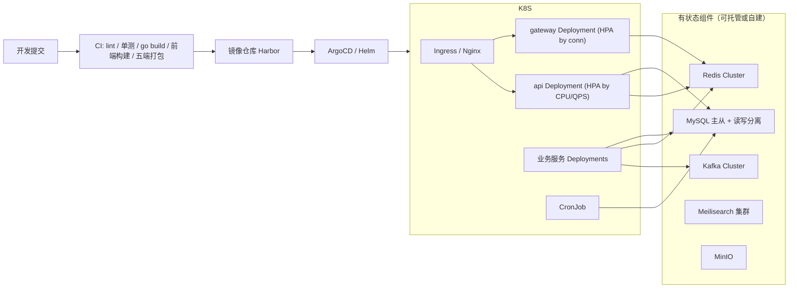

- **环境**：dev / test / staging / prod，配置走 ConfigMap + Secret，敏感信息对接 KMS/Vault。
- **发布**：无状态服务滚动更新；Gateway 更新采用「摘流量 → 等待连接自然迁移/优雅关闭 → 替换」；DB 变更使用向前兼容迁移（先加列，再改代码，后清理）。
- **私有化交付**：提供 `docker-compose`（单机）与 Helm Chart（集群）两套；五端安装包（H5 / 桌面 / 安卓 / 苹果 / 后台）由 CI 产出并附带校验和与签名。
- **音视频部署**：SFU 与 TURN 为有状态媒体服务，采用 `hostNetwork` 或 NodePort 暴露 UDP 端口范围（mediasoup 10000-59999 / coturn 49160-49200）；客户端通过 `rtc` 服务下发的节点列表就近接入，节点选择结果缓存于 Redis（`rtc:node:{roomId}`）；SFU 滚动更新采用「新房间调度到新节点 + 老节点等房间自然结束」策略，禁止硬杀导致通话中断。
- **灰度**：按网关节点 / 用户白名单灰度新协议版本，帧头 `v` 字段做兼容协商。
- **备份恢复**：MySQL 全备 + binlog、Redis RDB/AOF、宽表快照、Meilisearch dump/snapshot、MinIO 版本控制；每季度演练恢复，目标 RPO ≤ 5min / RTO ≤ 30min。

### 13.1 轻量化部署形态（单机 / 小型私有化）

标准版面向中大型私有化，依赖组件较多（Kafka + Redis Cluster + 宽表 + Meilisearch + MinIO + K8s + 全套可观测）。为覆盖小型私有化、分支节点、POC 演示与边缘部署，定义 **lite 轻量化形态**：保留全部消息可靠性与权限语义，仅替换/合并扩展性组件。

**适用边界**：并发长连接 ≤ 500、日活 ≤ 2000、日消息量 ≤ 10 万、单群 ≤ 200 人、消息留存 ≤ 90 天；单节点 2 核 4G（轻量负载）至 4 核 8G（上限负载）；无专职运维团队。

**组件清单与裁减规则**：

| 层 / 能力 | 标准版 | lite 轻量版 | 裁减规则与保留项 |
| --- | --- | --- | --- |
| 部署形态 | K8s + Helm + ArgoCD | 单节点 Docker Compose | 无状态服务合并为模块化单体进程，仅 `gateway` 与 `api` 分离；保留滚动升级脚本，去掉灰度编排 |
| 内部 RPC | gRPC + Protobuf | 进程内函数调用 | 单体阶段跳过网络 hop 与序列化，服务边界在代码层保留，可平滑拆回 |
| 消息队列 | Kafka 3.x | NATS JetStream（极简可 Redis Streams） | 保留主题/分区语义与至少一次投递、可重放；Redis Streams 无长期归档时，留存交由消息库 |
| 缓存 / 路由 | Redis Cluster 7.x | 单实例 Redis（开启 AOF） | 在线路由表、`seq` 自增、幂等键、限流键完全保留，仅取消分片 |
| 业务库 | MySQL 8 主从 + 读写分离 | 单实例 MySQL（或 PostgreSQL） | 关闭读写分离；事务模型、RBAC 表结构与审计表不变 |
| 消息库 | 宽表按 `conv_id` 分区（见 8.4）；中小规模可 MySQL 16 库 × 32 表 | 与业务库同实例、单表 + 按 `conversationId` 索引 | `clientMsgId` 幂等、单调 `seq`、漫游与撤回语义不变；数据量增长后先迁 MySQL 分片或宽表（见 8.4 迁移路径） |
| 检索 | Meilisearch（标准版同款，见第 3 章） | Meilisearch 单节点（可选 Typesense） | 与标准版同引擎、数据格式兼容，无需迁移；去掉多副本与集群编排，内置中文分词保留；复杂聚合需求可回落数据库精确查询 |
| 对象存储 | MinIO 分布式 / S3 | 本地 FS（或单盘 MinIO / SeaweedFS） | 保留分片上传与预签名 URL 接口，去掉多副本与纠删码 |
| 配置 / 发现 | etcd / Nacos | 文件配置 + Viper | 取消注册中心，服务地址静态配置；配置热更新改为进程 reload |
| 可观测 | Prometheus + Grafana + Loki/ELK + OpenTelemetry + Jaeger | VictoriaMetrics + Grafana + Loki，OTel Collector 直写 | 去掉 ELK 与独立 Jaeger，链路采样率下调至 10%（错误请求仍 100%）；核心告警项不变 |
| 音视频 | mediasoup SFU 集群 + coturn（多节点） | 单节点 mediasoup + coturn；1v1 优先 P2P + TURN | 群组通话仍走 SFU；并发低时不部署 SFU 集群编排，保留接通率与质量上报 |
| CI/CD | Harbor + Helm + ArgoCD 灰度 | GitHub Actions 直出镜像 + `docker compose up` | 保留签名校验与差分更新，去掉多环境灰度编排 |

**轻量版拓扑**：

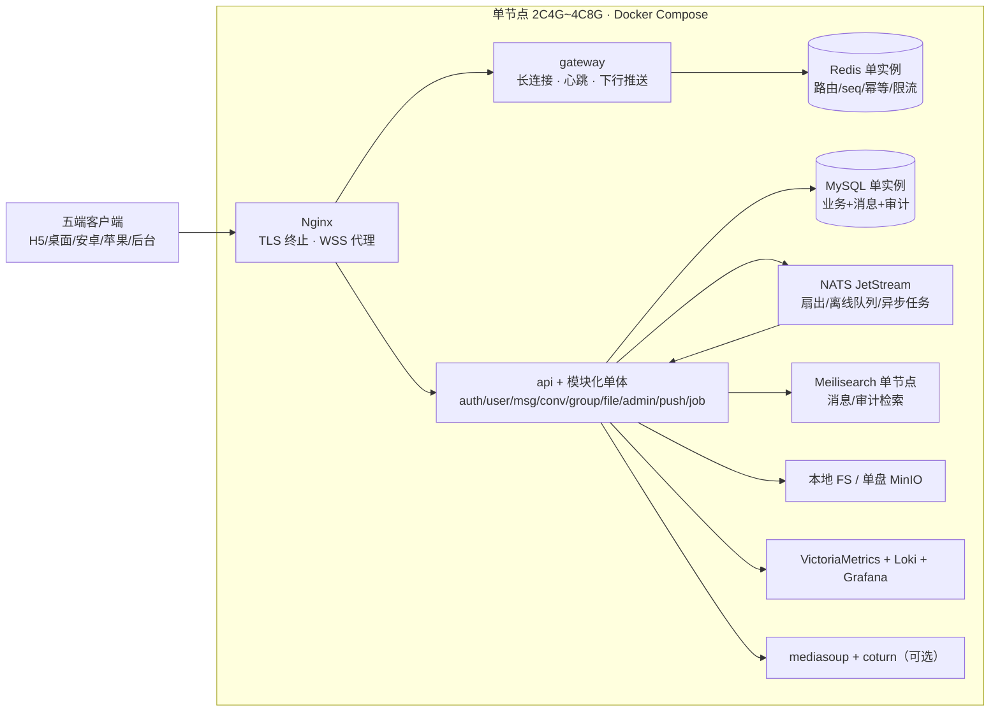

**配置开关**（`deployment.profile` 驱动，同一份代码切换形态）：

```yaml
deployment:
  profile: lite                 # lite | standard
  mode: singleNode              # singleNode | cluster
  services: monolith            # monolith | microservice
mq:
  driver: nats                  # standard: kafka
  stream: im-event
  replicas: 1
  retention: 7d
cache:
  driver: redis
  cluster: false                # standard: true
  aof: true
db:
  driver: mysql
  shards: 1                     # standard: 16
  replicas: 1                   # standard: 1 master + N replicas
  messageSharedInstance: true   # 消息库与业务库同实例
search:
  driver: meilisearch           # standard/lite 同款；复杂聚合可切 elasticsearch（见 8.4）
  replicas: 1                   # standard: 3
storage:
  driver: localFS               # standard: minio
observability:
  metrics: victoriametrics      # standard: prometheus
  tracingSample: 0.1
  jaeger: false
  elk: false
rtc:
  sfuNodes: 1
  clusterEnabled: false
```

**不可裁减项**（与标准版语义一致，轻量版必须保留）：TLS 1.3 与 WSS、JWT 鉴权与 RBAC 服务端二次校验、`clientMsgId` 幂等、服务端单调 `seq` 权威、落库后 ACK、撤回/已读/未读多端同步、审计日志、敏感词检测、消息加密存储。

**迁回标准版的触发条件**（满足任一即规划迁移）：并发长连接 > 500 或日消息量 > 10 万；需要多副本 HA / 跨机房容灾；消息留存 > 90 天或审计留存 > 180 天；单群 > 200 人；音视频并发通话 > 30；检索需复杂聚合分析（切 ES，见 8.4）。迁移路径：先将消息库迁至宽表（或 MySQL 分片）并扩 Redis Cluster，再切 Kafka 并将 Meilisearch 升为多副本集群（或按需换 ES），最后上 K8s 编排；因服务边界与协议层已预定义，可逐组件灰度切换（消息库双写迁移见 8.4）。

### 关键配置（示例）

```yaml
server:
  gateway:
    heartbeat: 30s
    connTimeout: 90s
    writeQueueSize: 1024
    maxConnsPerNode: 100000
message:
  retainDays: 180
  revokeWindowMin: 2
  fanoutBatchMs: 20
  idempotentTTL: 24h
auth:
  accessTokenTTL: 2h
  refreshTokenTTL: 7d
  verifyCodeTTL: 5m
  loginMaxFail: 5
  loginLockDuration: 10m
security:
  tlsMinVersion: "1.3"
  adminMfaRequired: true
  sensitiveWordStrategy: "block"   # block | replace | alert
file:
  maxSizeMB: 100
  maxVideoMB: 500
  signURLTTL: 15m
rbac:
  permCacheTTL: 10m
  superAdminBypass: true
rtc:
  sfuPortRange: "10000-59999"
  turnPortRange: "49160-49200"
  ringTimeout: 60s
  tokenTTL: 5m
  groupMaxVideo: 9
  groupMaxAudio: 32
  platformConcurrentCall: 500
  simulcastLayers: 3
  recordingEnabled: false
```

---

## 14. 可观测性

| 类别 | 关键项 |
| --- | --- |
| 业务指标 | 在线连接数、登录成功率、消息发送量/到达率、送达时延 P50/P95/P99、离线队列长度、撤回/敏感词命中量、并发通话数、接通率、通话时长、MOS/卡顿率/丢包率 |
| 系统指标 | Gateway goroutine 数、内存、FD、读写队列积压、Kafka 消费 lag、DB 慢查询、Redis 命中率 |
| 日志 | 结构化 JSON，含 `traceId / uid / convId / msgId / cmd / code / cost`；消息正文不进日志 |
| 链路 | OpenTelemetry 贯穿 `客户端 → Gateway → 服务 → DB/MQ`，采样率可动态配置，错误请求 100% 采样 |
| 告警 | 到达率 < 99.9%、P99 > 500ms、Kafka lag > 1 万、Gateway 节点掉线、异常登录激增、审计日志写入失败 |
| 看板 | Grafana：全局概览 / Gateway / 消息链路 / 存储 / 后台管理五个 Dashboard |

---

## 15. 测试策略

| 层级 | 内容 | 工具 |
| --- | --- | --- |
| 单元 | 领域逻辑、幂等、seq、DFA 敏感词、数据范围 SQL 生成 | `go test` + `testify`、Vitest |
| 集成 | API + MySQL/Redis/Kafka Testcontainers | Testcontainers-go |
| 协议 | 帧编解码兼容性、命令字、错误码 | golden case + fuzz |
| 端到端 | 五端登录、收发、撤回、已读、离线、多端同步 | Playwright（H5/后台）+ Electron 自动化 + Android/iOS 真机/模拟器自动化 |
| 可靠性 | 断网、丢包、节点重启、MQ 积压、主从切换 | 混沌演练脚本 |
| 性能 | 10 万长连接、5000 写 QPS、大群扇出 | 自研 Go 压测客户端 / k6 |
| 安全 | 越权矩阵、重放、注入、XSS、上传、脱敏 | ZAP + 手工用例 |
| 兼容 | Windows / macOS / Linux 三平台安装包与托盘/通知/更新；Android 8+ / iOS 14+ 机型、横竖屏与平板布局、深色模式跟随系统（NFR-COMP-03） | 三平台冒烟清单 + 原生端机型兼容矩阵 |
| 音视频 | 信令状态机（呼叫/接听/拒绝/取消/挂断）、SDP 与 ICE 协商、P2P/TURN/SFU 三种模式、弱网（丢包 3%/10%、带宽 200kbps）、多端来电、录制与回放、强制挂断 | 自研 Go 媒体探针 + Chrome Headless WebRTC + 弱网模拟（tc/netem） |

---

## 16. 风险与演进

| 风险 | 影响 | 缓解 / 演进 |
| --- | --- | --- |
| 早期微服务过多导致运维复杂 | 交付慢 | 模块化单体起步，按第 4 章边界预置拆分能力 |
| 宽表不支持跨会话查询 / 聚合 | 统计/审计复杂 | 统计走 Kafka → 聚合表 / ClickHouse；审计与全文检索走 Meilisearch（复杂聚合可切 ES），宽表仅按 `conv_id` 提供定点与范围读 |
| 大群扇出热点 | 延迟上升 | 读扩散 + 合并窗口 + 在线分批 + 离线拉取 |
| 消息留存成本 | 存储膨胀 | 冷热分层（近 30 天热库，历史归档对象存储）+ 压缩 |
| 桌面端三平台差异 | 体验不一致 | 原生适配层 + 降级策略 + 平台冒烟清单 |
| 权限配置漂移 | 越权或误拦截 | 接口权限自动生成、前后端同一份权限码、越权自动化测试 |
| Electron 内存占用 | 低端机卡顿 | 本地缓存分页加载、虚拟列表、Tauri 迁移预案 |
| 企业网络阻断 UDP/WebRTC | 通话不可用 | TURN 中继必部署；连通性探测失败降级为纯语音或回落消息提示 |
| SFU 单点故障 | 通话中断 | 房间与节点绑定外置 Redis；故障按房间整体迁移；新房间调度到健康节点 |
| 端到端加密通话 | 协议改造 | 通过 Insertable Streams / SFrame 在 V2.0 引入，媒体面不改架构 |

---

## 17. 交付物清单

| 交付物 | 路径 / 形式 |
| --- | --- |
| 业务需求文档 | `docs/01-业务需求文档.md` |
| 技术架构文档 | 本文档 `docs/02-技术架构文档.md` |
| 可交互原型 | `prototype/index.html`（H5 / 桌面客户端 / 管理后台） |
| 服务端源码 | `im-server/`（按第 4.1 节结构） |
| 协议定义 | `api/proto/*.proto` |
| 数据库字典与迁移 | `scripts/migrations/` |
| 接口文档 | OpenAPI 3.1（由 Gin 注解生成） |
| 部署产物 | Dockerfile / Helm Chart / docker-compose |
| 客户端产物 | H5 静态包、Windows NSIS、macOS dmg、Linux AppImage/deb |
| 音视频产物 | SFU 镜像（mediasoup + 编排）、TURN 镜像（coturn）、录制服务、UDP 端口与网络策略清单 |
| 运维手册 | 部署、扩容、备份恢复、告警处置 |
